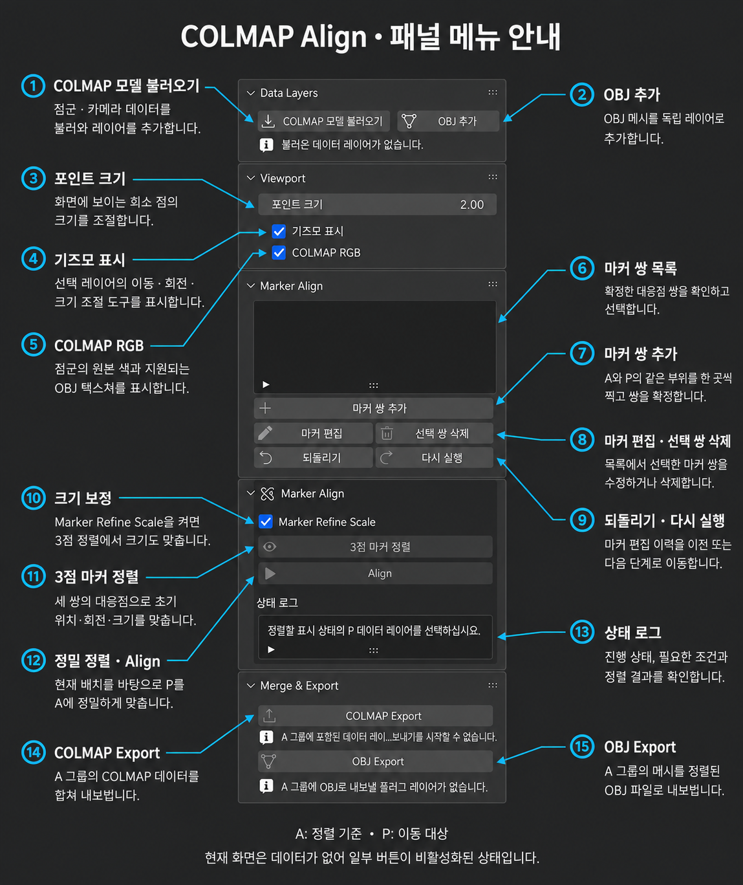
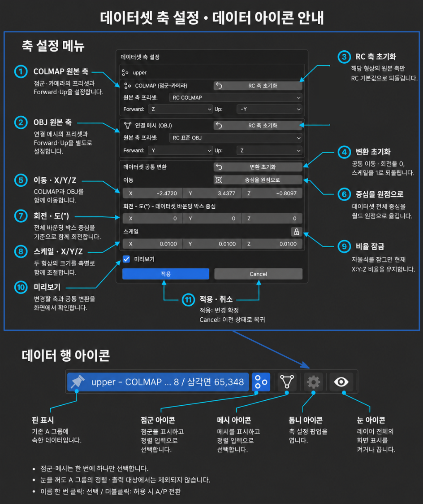
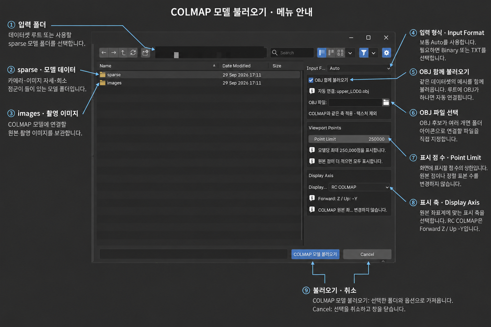

# COLMAP Align 기능 매뉴얼

[매뉴얼 목록](README.md) · [Notion 원본](https://app.notion.com/p/3d7426a1abfa818585a9de2fec9f244f?pvs=204) · 추출일: 2026-10-28

COLMAP 점군·카메라와 OBJ 메시의 위치, 방향, 크기를 맞추고 결과를 내보내는 도구입니다.

---

<b>목차</b>

<!-- 목차 시작 -->

- [이럴 때 사용하세요](#section-01)
- [1. Colmap Align 열기](#section-02)
- [2. 데이터 불러오기](#section-03)
- [3. 색상 표시 바꾸기](#section-04)
- [4. 기즈모로 배치 조절하기](#section-05)
- [5. 마커로 정렬하기](#section-06)
- [6. COLMAP 내보내기](#section-07)
- [7. RC로 가져오기](#section-08)
- [추가 설정](#section-09)

<!-- 목차 끝 -->

---

<br />

<a id="section-01"></a>

### <b>이럴 때 사용하세요</b>

- 앞면·뒷면 등 같은 촬영 대상의 데이터셋이 두 갈래로 나뉘어, <b>수동으로 이어 붙이고 싶을 때</b>.
- <b>Projection Painting 등의 작업을 위해</b>, 점군과 메시 또는 같은 대상의 데이터셋들을 <b>같은 좌표계로 맞추고 싶을 때</b>.

<br />

<table>
<tr>
<td width="50%"></td>
<td width="50%"></td>
</tr>
</table>

<br />

<a id="section-02"></a>

### 1. Colmap Align 열기

---

- <b>Window → COLMAP Tools → COLMAP Align</b>을 선택합니다.
- 왼쪽은 기준 <b>A</b>, 오른쪽은 움직일 <b>P</b> 화면입니다.

<!-- 원본 영상: media/align/01-align-launch.mp4 -->

https://github.com/user-attachments/assets/3d9ccf34-77d4-4827-9ac1-28b064459336

<br />

<a id="section-03"></a>

### 2. 데이터 불러오기

---

```c++
colmap_a/                     ← 불러올 데이터셋 폴더
├─ images/
│  ├─ image_001.jpg
│  └─ image_002.jpg
├─ sparse/
│  └─ 0/
│     ├─ cameras.bin or txt
│     ├─ images.bin or txt
│     └─ points3D.bin or txt
└─ model.obj                ← 연결 OBJ가 있을 때만

// TXT 모델은 같은 위치에 cameras.txt, images.txt, points3D.txt를 둡니다.
```



1. <b>N패널 → COLMAPAlign → COLMAP 모델 추가</b>를 누릅니다.
2. 데이터셋 폴더를 선택하고 <b>COLMAP 모델 불러오기</b>를 실행합니다.
3. 같은 방법으로 추가할 데이터셋도 불러옵니다.

<br />

처음 불러온 데이터는 <b>A</b>, 이후 데이터는 <b>P</b>로 등록됩니다.

<!-- 원본 영상: media/align/02-align-colmap-import.mp4 -->

https://github.com/user-attachments/assets/af95a4be-4f6c-40bb-b2a7-d0ca81ba5634

> 📁 촬영 이미지가 있는 <code>images/</code>와 모델이 있는 <code>sparse/</code>를 함께 준비하세요. 연결 OBJ가 있다면 데이터셋 루트에 두고 <b>OBJ 함께 불러오기</b>를 켭니다.

<br />

<a id="section-04"></a>

### 3. 색상 표시 바꾸기

---

<b>Viewport → COLMAP RGB를 켜거나 끕니다.</b>

- <b>켬:</b> 점군의 원래 색을 표시합니다.
- <b>끔:</b> A는 청록색, P는 주황색으로 구별합니다.

<!-- 원본 영상: media/align/03-align-rgb-toggle.mp4 -->

https://github.com/user-attachments/assets/5bc8d477-4dbc-4c1b-a5e1-a9802ccc48af

<br />

<a id="section-05"></a>

### 4. 기즈모로 배치 조절하기

---

<b>두 데이터가 크게 떨어져 있거나 방향·크기가 다를 때 사용합니다.</b>

1. <b>Data Layers</b>에서 조절할 레이어를 선택합니다.
2. <b>Viewport → 기즈모 표시</b>를 켭니다.
3. 기즈모로 이동·회전·크기를 조절하여 공통 부위를 찾기 쉽게 배치합니다.

<!-- 원본 영상: media/align/04-align-gizmo.mp4 -->

https://github.com/user-attachments/assets/d99e6ca8-df2c-4810-8496-4329a26d41ae

<br />

<a id="section-06"></a>

### 5. 마커로 정렬하기

---

A와 P에서 <b>실제로 같은 부위</b>를 세 쌍 지정합니다.

1. <b>마커 쌍 추가</b>를 누르고 양쪽 화면에서 대응점을 선택합니다.
2. <b>쌍 지정</b>으로 확정합니다. 같은 방법으로 총 <b>세 쌍</b>을 만듭니다.
3. 크기도 맞춰야 한다면 <b>Marker Refine Scale</b>을 켭니다. <b>3점 마커 정렬</b>을 실행합니다.
4. 초기 배치를 확인한 뒤 <b>Align</b>을 눌러 정밀 정렬합니다.
5. 화면과 상태 로그를 확인하고 <b>정렬 승인</b>을 누릅니다. 맞지 않으면 <b>결과 버리기</b>를 선택합니다.

<!-- 원본 영상: media/align/05-align-markers-and-approval.mp4 -->

https://github.com/user-attachments/assets/687ad6af-123d-4e80-a492-d6a41f96bc16

> 💡 마커는 한곳에 몰리거나 일직선이 되지 않게 배치하세요. 승인한 P는 A 그룹으로 편입됩니다.

<br />

<a id="section-07"></a>

### 6. COLMAP 내보내기

---

- 정렬된 COLMAP데이터를 colmap\_merged폴더로  내보냅니다.
- 결과는 선택한 부모 폴더 아래 <b><code>colmap_merged/</code></b>에 저장됩니다.

```txt
내보낸 폴더 구조 · TXT 예시
	- 	Binary를 선택하면 sparse/0/의 다섯 모델 파일은 .bin으로 저장됩니다.
	- 	이미지 파일명과 하위 폴더는 데이터에 따라 달라집니다.

colmap_merged/
├─ images/                  ← 촬영 이미지
│  ├─ image_001.jpg
│  └─ image_002.jpg...
├─ sparse/
│  └─ 0/
│     ├─ rigs.txt            ← 리그 구성
│     ├─ cameras.txt         ← 카메라 정보
│     ├─ frames.txt          ← 프레임 정보
│     ├─ images.txt          ← 이미지별 카메라 자세
│     └─ points3D.txt        ← 정렬된 희소 점군
├─ merge_report.json        ← 병합 결과 보고서
└─ merge_id_map.npz         ← 원본·출력 ID 대응표
```

1. 출력할 데이터가 <b>A 그룹</b>에 있는지 확인합니다.
2. <b>Merge & Export → COLMAP Export</b>를 누릅니다.
3. 입력 데이터셋 밖의 출력 부모 폴더와 <b>Sparse Format</b>을 선택합니다. RC로 가져갈 때는 <b>TXT</b>를 사용합니다.
4. 원래 COLMAP 축으로 출력하려면 <b>Import 축변환 되돌리기</b>를 켭니다.

<!-- 원본 영상: media/align/06-align-colmap-export.mp4 -->

https://github.com/user-attachments/assets/3d72eaa2-51cb-49f6-8591-e686ef499338

<br />

<br />

<a id="section-08"></a>

### 7. RC로 가져오기

---

영상의 프로그램은 <b>RealityScan</b>입니다.

1. RC에서 <b>Open…</b> 또는 <b>Ctrl+O</b>를 실행합니다.
2. 파일 형식을 <b>Colmap Text Format</b>으로 바꾸고, <b><code>colmap_merged/sparse/0/camera.txt</code></b>  오픈
3. 이미지를 찾지 못하면 <b>예</b>를 누르고 <b><code>colmap_merged/images/</code></b>에서 안내된 파일명과 같은 이미지를 지정합니다.
4. 카메라 배치·점군·촬영 이미지가 표시되는지 확인합니다.

<!-- 원본 영상: media/align/07-align-realityscan-import.mp4 -->

https://github.com/user-attachments/assets/3176fe6e-2cab-45bc-88b8-5e397f6f936c

<br />

<a id="section-09"></a>

## 추가 설정

---

필요한 항목만 펼쳐 보세요.

<details>
<summary><b>COLMAP 데이터 없이 OBJ 메시끼리의 정렬</b></summary>

영상은 방향이 다른 같은 대상의 두 OBJ 메시를 대응점으로 맞추는 예시입니다.

1. <b>OBJ 추가</b>로 두 메시를 불러오고, <b>A(기준)</b>와 <b>P(이동 대상)</b>를 확인합니다.
2. 같은 부위에 <b>마커 세 쌍</b>을 지정하고, <b>3점 마커 정렬</b>로 초기 위치·방향·크기를 맞춥니다.
3. <b>Align</b>으로 정밀 정렬한 뒤 <b>정렬 승인</b>으로 확정합니다.

<!-- 원본 영상: media/align/obj-alignment.mp4 -->

https://github.com/user-attachments/assets/1ff02c30-a9c0-4503-90ed-2c533ed57273

-  정렬한 메시를 파일로 저장하려면 <b>OBJ Export</b>를 사용합니다.<br />-  추가적으로 점군 - 메시간에도 정렬 가능

</details>

<br />
