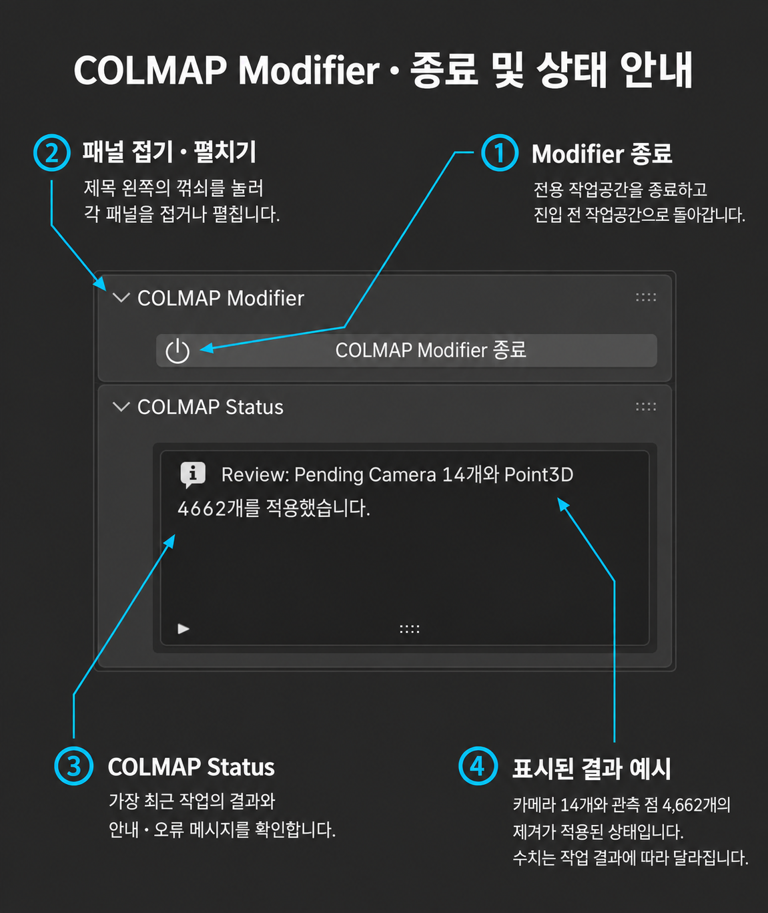
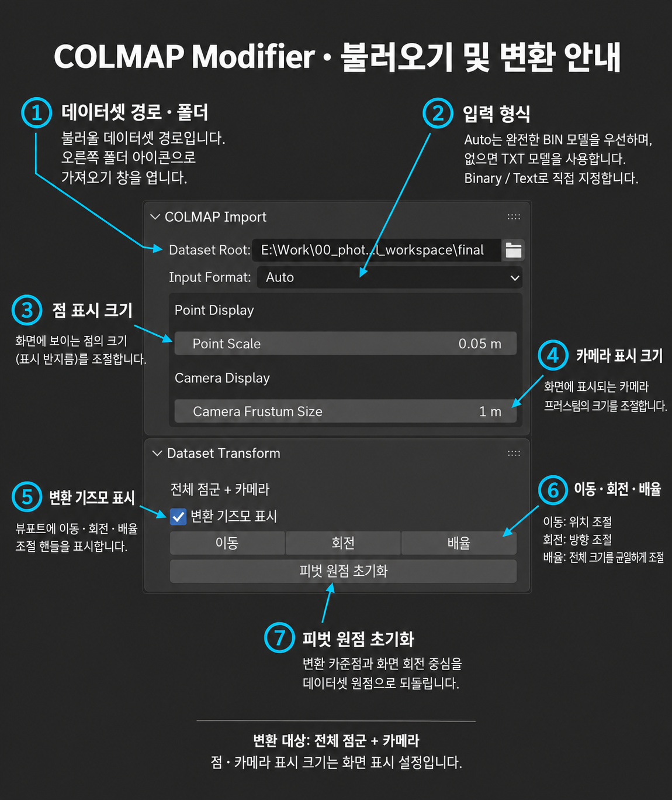
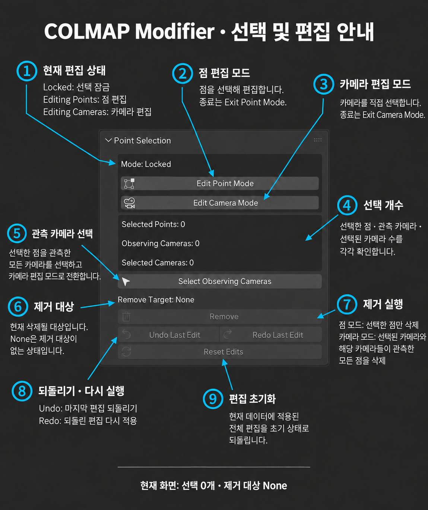
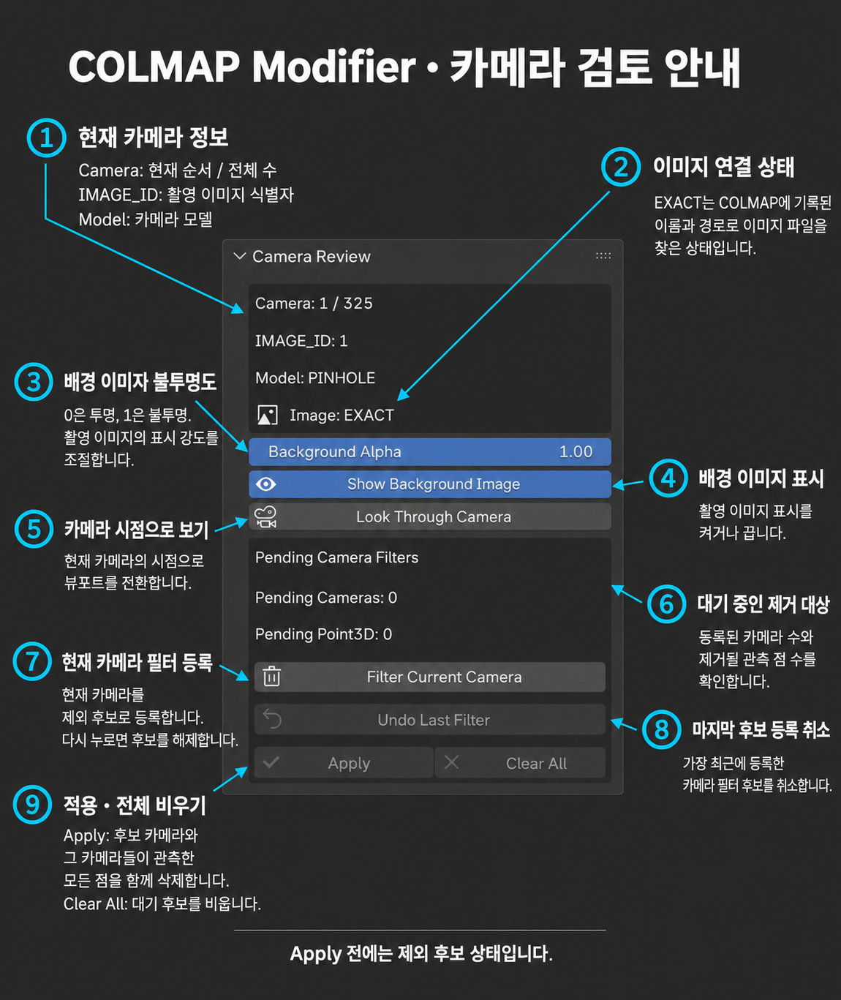
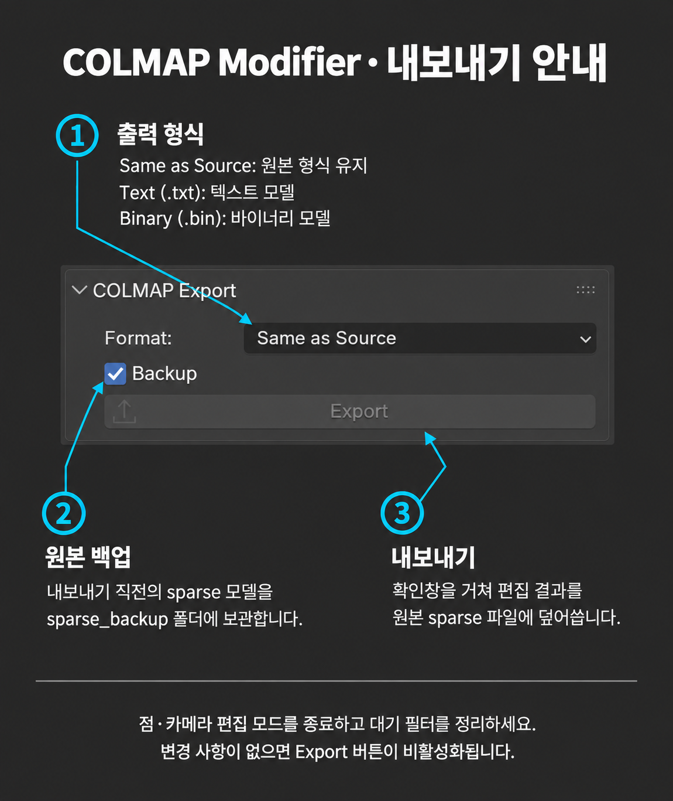

# COLMAP Modifier 기능 매뉴얼

[매뉴얼 목록](README.md) · [Notion 원본](https://app.notion.com/p/3ed426a1abfa8113b6d1f8271ab7f409?pvs=204) · 추출일: 2026-10-28

COLMAP 희소 점군과 카메라를 검토하고, 불필요한 데이터를 정리하거나 위치·방향·크기를 조절하는 도구입니다.

---

<b>목차</b>

<!-- 목차 시작 -->

- [이럴 때 사용하세요](#section-01)
- [1. COLMAP Modifier 열기](#section-02)
- [2. 데이터 불러오기](#section-03)
- [3. 기즈모로 배치 조절하기](#section-04)
- [4. 점·카메라 표시 크기 바꾸기](#section-05)
- [5. 카메라 편집 모드 사용하기](#section-06)
- [6. 선택한 점을 관측한 카메라 찾기](#section-07)
- [7. 선택한 점 제거하기](#section-08)
- [8. 촬영 이미지를 보며 카메라 필터링하기](#section-09)
- [9. 편집 결과 내보내기](#section-10)

<!-- 목차 끝 -->

---

<a id="section-01"></a>

### <b>이럴 때 사용하세요</b>

- 촬영 대상 주변의 <b>배경 점이나 불필요한 점군을 제거하고 싶을 때</b>.
- 특정 부위를 촬영한 카메라를 찾거나, <b>불필요한 촬영 시점을 골라 제외하고 싶을 때</b>.
- 후속 작업에 맞게 <b>점군과 카메라를 함께 이동·회전하거나 크기를 조절하고 싶을 때</b>.

<table>
<tr>
<td width="50%"></td>
<td width="50%"></td>
</tr>
</table>

<a id="section-02"></a>

### 1. COLMAP Modifier 열기

---

- <b>Window → COLMAP Tools → COLMAP Modifier</b>를 선택합니다.
- 전용 작업공간이 열리면 오른쪽 <b>COLMAP Modifier</b> 패널에서 작업합니다.

[▶ 동영상 보기: 01-modifier-launch.mp4](media/modifier/01-modifier-launch.mp4)

<a id="section-03"></a>

### 2. 데이터 불러오기

---

```txt
colmap_edit/                 ← 불러올 데이터셋 폴더
├─ images/                   ← 촬영 이미지
│  ├─ image_001.jpg
│  └─ image_002.jpg
└─ sparse/
   └─ 0/
      ├─ cameras.bin
      ├─ images.bin
      └─ points3D.bin

TXT 모델은 같은 위치에 cameras.txt, images.txt, points3D.txt를 둡니다.
```

1. <b>COLMAP Import → Dataset Root 오른쪽 폴더 아이콘</b>을 누릅니다.
2. 데이터셋 폴더와 <b>Input Format</b>을 확인하고 <b>Import</b>를 실행합니다.
3. 불러오기가 끝나면 <b>COLMAP Status</b>와 화면의 점군·카메라를 확인합니다.

[▶ 동영상 보기: 2.Colmap_Modifer_import.mp4](media/modifier/2.Colmap_Modifer_import.mp4)

> 📁 Modifier의 <b>Export는 불러온 sparse 파일을 덮어씁니다.</b> 원본을 유지하려면 데이터셋을 복사한 뒤 작업용 폴더를 불러오세요.

<a id="section-04"></a>

### 3. 기즈모로 배치 조절하기

---

<b>점군과 카메라의 위치 관계를 유지하면서 데이터셋 전체를 함께 조절합니다.</b>

1. 점·카메라 편집 모드를 종료하고 <b>Dataset Transform → 변환 기즈모 표시</b>를 켭니다.
2. 축 화살표로 <b>이동</b>, 회전 링으로 <b>회전</b>, 중앙 핸들로 <b>균일 배율</b>을 조절합니다.
3. 드래그 후 놓으면 확정됩니다. 취소하려면 <b>Esc</b> 또는 <b>오른쪽 클릭</b>을 사용합니다.

[▶ 동영상 보기: 3._colmap_modifier_gizmo.mp4](media/modifier/3._colmap_modifier_gizmo.mp4)

> 💡 <b>뷰포트의 G / R / S로도 이동·회전·배율 조절을 시작할 수 있습니다. </b>

<a id="section-05"></a>

### 4. 점·카메라 표시 크기 바꾸기

---

<b>COLMAP Import에서 화면에 보이는 점과 카메라의 크기를 조절합니다.</b>

<b>표시 크기 설정은 실제 데이터의 좌표·배율을 바꾸지 않습니다. 실제 크기를 바꾸려면 Dataset Transform → 배율을 사용합니다.</b>

- <b>Point Display → Point Scale :</b> 점군의 표시 크기.
- <b>Camera Display → Camera Frustum Size :</b> 카메라 Frustom의 표시 크기.

[▶ 동영상 보기: 04-modifier-display-size.mp4](media/modifier/04-modifier-display-size.mp4)

<a id="section-06"></a>

### 5. 카메라 편집 모드 사용하기

---

<b>잘못 정렬된 카메라를 선택하고, 해당 카메라가 관측한 타이포인트들을 모두 제거합니다.</b>



1. <b>Point Selection → Edit Camera Mode</b>로 들어갑니다.
2. 뷰포트에서 제거할 카메라를 선택합니다. 영상처럼  여러 카메라를 선택할 수 있습니다.
3. <b>Remove</b>를 실행해 선택된 카메라와 <b>해당 카메라들이 관측한 모든 점</b>을 삭제합니다.
4. 결과를 확인한 뒤 <b>Exit Camera Mode</b>로 종료합니다.

[▶ 동영상 보기: 05-modifier-camera-mode-2k.mp4](media/modifier/05-modifier-camera-mode-2k.mp4)

> 💡 잘못 제거했다면 <b>Undo Last Edit</b>로 되돌립니다. 카메라를 선택한 뒤 데이터 삭제에는 패널의 <b>Remove</b> 버튼을 사용하세요.

<a id="section-07"></a>

### 6. 선택한 점을 관측한 카메라 찾기

---

<b>선택한 점을 관측한 모든 카메라를 선택 → 해당 카메라들이 관측한 모든 점을 삭제할때 사용</b>

1. <b>Point Selection → Edit Point Mode</b>로 들어가 확인할 점을 선택합니다.
2. <b>Select Observing Cameras</b>를 누릅니다. <br /><b>선택한 점을 관측한 모든 카메라</b>가 선택되며 <b>카메라 편집 모드로 전환</b>됩니다.
3. 선택된 카메라를 확인합니다. 제거하려면 <b>Remove Target의 카메라·관측 점 수</b>를 확인한 뒤 <b>Remove</b>를 실행합니다.
4. 작업을 마치면 <b>Exit Camera Mode</b>로 종료합니다.

[▶ 동영상 보기: 05-modifier-2k-12fps-vbr.mp4](media/modifier/05-modifier-2k-12fps-vbr.mp4)

> 💡 <b>선택한 점만 제거하려면 아래 7번 절차</b>를 사용하세요.

<a id="section-08"></a>

### 7. 선택한 점 제거하기

---

<b>카메라를 유지하면서 배경이나 불필요한 점만 정리합니다.</b>

1. <b>Point Selection → Edit Point Mode</b>로 들어가 제거할 점을 선택합니다.
2. <b>Remove Target: Selected Points</b>인지 확인하고 <b>Remove</b>를 실행합니다.
3. 결과를 확인합니다. 잘못 제거했다면 <b>Undo Last Edit</b>로 되돌립니다.
4. 작업을 마치면 <b>Exit Point Mode</b>로 종료합니다.

[▶ 동영상 보기: 06-modifier-remove-points.mp4](media/modifier/06-modifier-remove-points.mp4)

<a id="section-09"></a>

### 8. 촬영 이미지를 보며 카메라 필터링하기

---

<b>카메라 시점에서 촬영 이미지를 검토하고, 제외할 카메라를 모아 한 번에 적용합니다.</b>



1. 점·카메라 편집 모드를 종료하고 <b>Camera Review → Look Through Camera</b>를 누릅니다.
2. <b>Show Background Image</b>를 켜고 <b>Background Alpha</b>로 이미지 표시 강도를 조절합니다.
3. 타임라인에서 촬영 시점을 바꾸며 확인하고, 제외할 시점에서 <b>Filter Current Camera</b>를 누릅니다.
4. <b>Pending Cameras / Pending Point3D</b>를 확인한 뒤 <b>Apply</b>로 확정합니다.

[▶ 동영상 보기: 7_colmap_modifier_filter_camera.mp4](media/modifier/7_colmap_modifier_filter_camera.mp4)

현재 후보를 해제하려면 <b>Unfilter Current Camera</b>, 마지막 후보 등록을 취소하려면 <b>Undo Last Filter</b>, 전체 대기를 비우려면 <b>Clear All</b>을 사용합니다.

> 💡 <b>Apply 전에는 제외 후보 상태입니다.</b> 대기 필터가 남아 있으면 다른 편집이나 Export가 제한되므로 <b>Apply</b> 또는 <b>Clear All</b>로 정리하세요. 이미 적용한 편집은 <b>Undo Last Edit</b>로 되돌립니다.

<a id="section-10"></a>

### 9. 편집 결과 내보내기

---

<b>편집한 점군·카메라와 데이터셋 변환 결과를 COLMAP sparse 모델에 반영합니다.</b>



```txt
// 백업 폴더 구조 예시

colmap_edit/
├─ images/                         ← 촬영 이미지
├─ sparse/
│  └─ 0/                           ← 내보내기 결과
│     ├─ cameras.bin
│     ├─ images.bin
│     └─ points3D.bin
└─ sparse_backup/
   └─ 20261004T063000Z_a1b2c3d4/    ← 내보내기 직전 원본 백업
      └─ 0/
         ├─ cameras.bin
         ├─ images.bin
         └─ points3D.bin
```

1. 점·카메라 편집 모드를 종료하고, 대기 필터를 <b>Apply</b> 또는 <b>Clear All</b>로 정리합니다.
2. <b>COLMAP Export → Format</b>에서 <b>Same as Source(원본 형식 유지)</b>, <b>Text (.txt)</b>, <b>Binary (.bin)</b> 중 출력 형식을 선택합니다.
3. <b>Backup</b>을 켜고 <b>Export</b>를 누릅니다.
4. 확인창에서 <b>대상 경로·출력 형식·백업 설정</b>을 확인한 뒤 <b>Export</b>로 실행합니다.
5. 진행창이 완료되면 <b>COLMAP Status</b>에서 내보내기 결과를 확인합니다.

[▶ 동영상 보기: 09-modifier-export.mp4](media/modifier/09-modifier-export.mp4)

> 📁 <b>불러온 sparse 파일을 덮어씁니다.</b> Backup을 켜면 내보내기 직전 원본을 <b>sparse\_backup</b>에 보관합니다. 내보낸 디스크 파일의 이전 상태는 <b>백업으로 복원</b>합니다.

출력 형식을 바꾸면 이전 형식의 모델 파일은 제거됩니다. 내보내기가 완료되면 편집 이력이 초기화됩니다.
