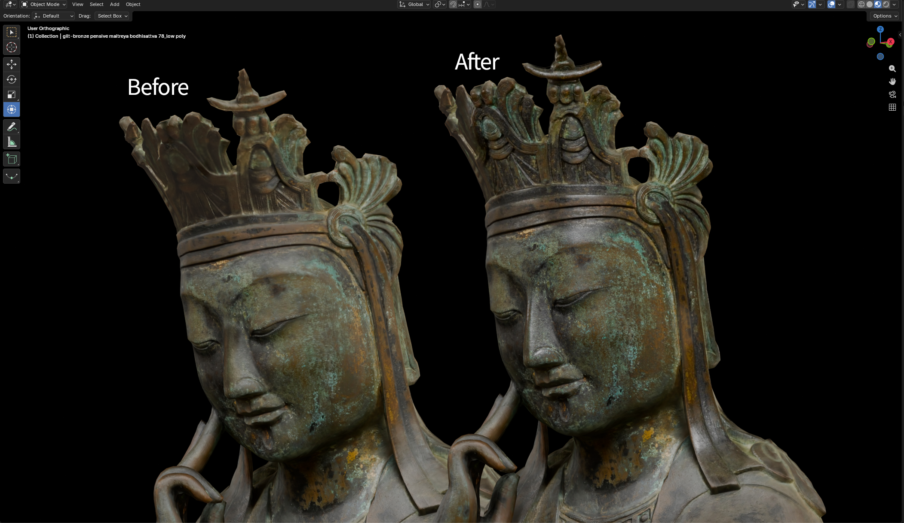
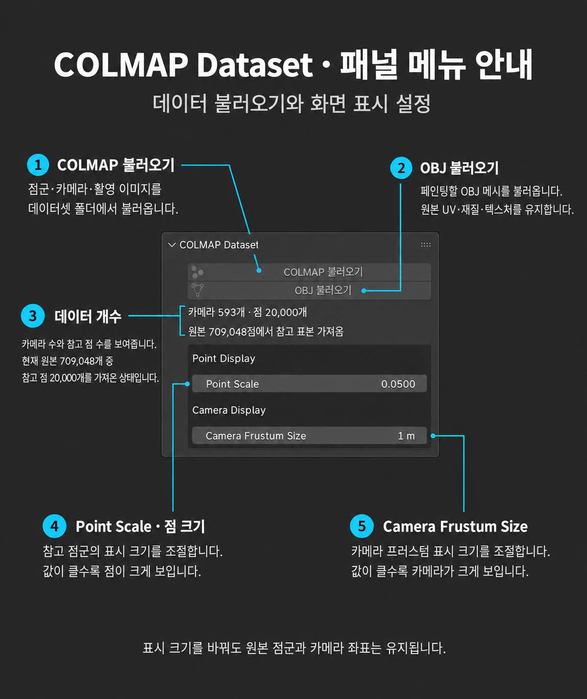
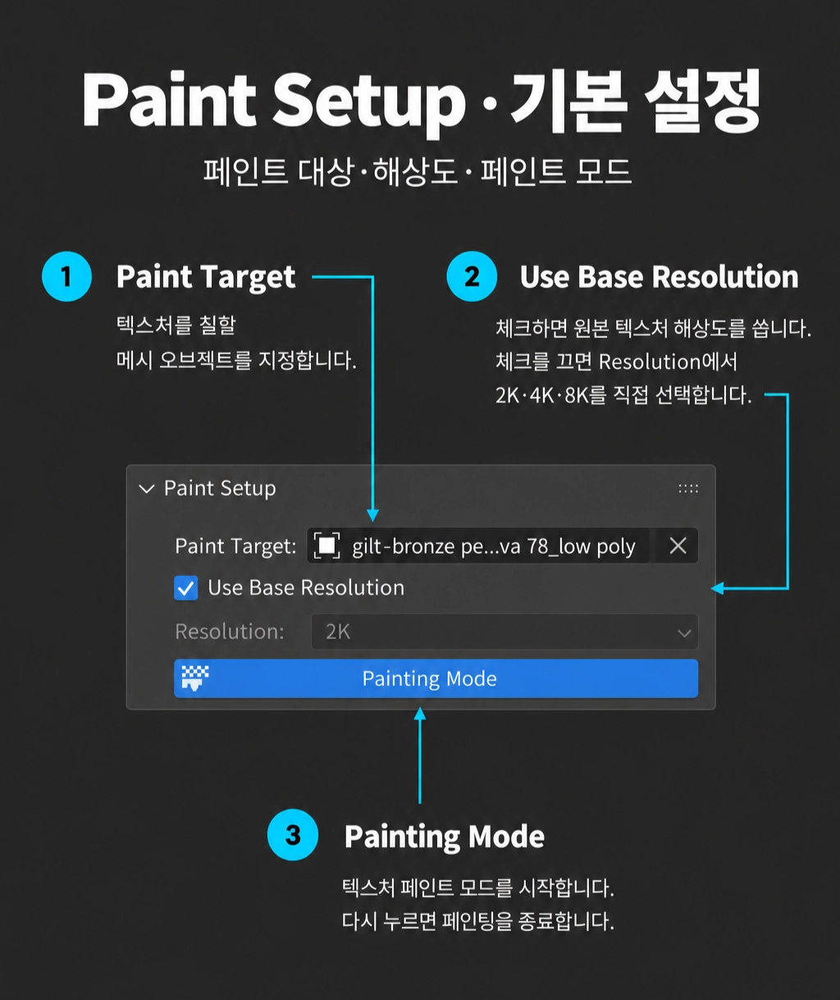
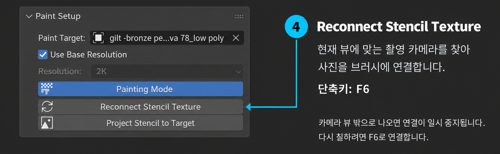

# Projection Painting 기능 매뉴얼

[매뉴얼 목록](README.md) · [Notion 원본](https://app.notion.com/p/3f1426a1abfa81edaf4fc21248045841?pvs=204) · 추출일: 2026-10-28

COLMAP 촬영 이미지를 메시 표면에 투영해 텍스처를 보정하고, 레이어·마스크·색 보정과 복제 브러시로 결과를 다듬는 도구입니다.

---

<b>목차</b>

<!-- 목차 시작 -->

- [이럴 때 사용하세요](#section-01)
- [1. Projection Painting 열기](#section-02)
- [2. COLMAP·OBJ 불러오기와 페인팅 시작](#section-03)
- [3. 촬영 이미지와 모델 비교하기](#section-04)
- [4. 스텐실 연결 및 해제하기](#section-05)
- [5. 페인트 레이어 추가하기](#section-06)
- [6. 촬영 이미지로 필요한 부분 칠하기](#section-07)
- [7. 잘못 칠한 부분 지우기](#section-08)
- [8. 레이어 켜기·끄기](#section-09)
- [9. 레이어 단독 보기](#section-10)
- [10. 밝기·노출·색상 보정하기](#section-11)
- [11. 마스크로 보정 범위 조절하기](#section-12)
- [12. Composite 만들기·해제하기](#section-13)
- [13. Clone 브러시로 색 복제하기](#section-14)
- [14. 보정한 텍스처 내보내기](#section-15)

<!-- 목차 끝 -->

---

### <b>이럴 때 사용하세요</b>

- 포토그래메트리 모델의 흐릿한 텍스처나 경계부를 <b>원본 촬영 이미지로 보완하고 싶을 때</b>.
- 촬영 시점별 보정 결과를 <b>레이어로 나누고, 마스크·색 보정·복제 브러시로 필요한 부분만 수정하고 싶을 때</b>.

<b>보정 전·후 예시</b>

### 1. Projection Painting 열기

---

- <b>Window → COLMAP Tools → Projection Painting</b>을 선택합니다.
- 전용 작업공간이 열리면 오른쪽 <b>Projection Paint</b> 패널에서 작업합니다.

<!-- 원본 영상: media/painter/01-projection-open.mp4 -->

https://github.com/user-attachments/assets/ffb8e2be-6a82-417c-81a7-2baf130793a5

### 2. COLMAP·OBJ 불러오기와 페인팅 시작

---

<b>촬영 카메라·이미지와 칠할 메시를 준비합니다.</b>

1. <b>COLMAP Dataset → COLMAP 불러오기</b>에서 촬영 이미지와 sparse 모델이 있는 데이터셋 폴더를 선택합니다.
2. <b>OBJ 불러오기</b>로 메시를 가져옵니다.
3. <b>Paint Setup → Paint Target</b>에 칠할 메시를 지정합니다. 원본 텍스처 크기를 유지하려면 <b>Use Base Resolution</b>을 켜고, 직접 정하려면 끈 뒤 <b>Resolution</b>을 선택합니다.
4. <b>Painting Mode</b>를 누르고 준비가 끝날 때까지 기다립니다.

<table>
<tr>
<td width="50%"></td>
<td width="50%"></td>
</tr>
</table>

<!-- 원본 영상: media/painter/02-projection-import-paint-mode.mp4 -->

https://github.com/user-attachments/assets/5a401da2-ce06-4df3-bfa4-f42874042b13

> 📁 메시에는 <b>UV</b>가 있어야 하며, COLMAP 카메라와 <b>같은 좌표계</b>에 있어야 합니다. 위치·방향·크기가 다르면 [COLMAP Align 기능 매뉴얼](ALIGN.md)에서 먼저 정렬합니다.

### 3. 촬영 이미지와 모델 비교하기

---

<b>배경 사진을 켜고 모델과 촬영 이미지가 맞는지 확인합니다.</b>

1. 타임라인에서 사용할 촬영 시점을 선택하고 <b>Camera Review → IMAGE\_ID / Image</b>를 확인합니다.
2. <b>Show Background Image</b> 또는 <b>F7</b>로 배경 사진을 켜거나 끕니다.
3. <b>Background Alpha</b>로 사진의 표시 강도를 조절합니다.

<!-- 원본 영상: media/painter/03-projection-background.mp4 -->

https://github.com/user-attachments/assets/e784a957-a85f-4149-bb54-4bc4b6dcf47a

배경 사진 표시는 비교용입니다. 사진으로 칠할 때는 아래의 스텐실 연결 상태도 확인합니다.

### 4. 스텐실 연결 및 해제하기

---

<b>촬영 사진을 브러시에 연결하거나 연결을 해제해, 사진 투영과 일반 뷰 작업을 전환합니다.</b>

1. 일반 뷰에서 칠할 부위가 보이도록 시점을 잡습니다.
2. <b>Paint Setup → Reconnect Stencil Texture</b> 또는 <b>F6</b>를 누릅니다.
3. 전환된 카메라 시점과 <b>Status → Stencil: CONNECTED</b>를 확인합니다.
4. 연결을 해제하려면 화면을 회전해 <b>카메라 뷰 밖으로 나옵니다.</b>

<b>스텐실 연결하기</b>

<!-- 원본 영상: media/painter/04-projection-reconnect-stencil.mp4 -->

https://github.com/user-attachments/assets/18ca4c54-80c1-430d-83ae-bf6cb4e37194

<b>스텐실 연결 해제하기</b>

<!-- 원본 영상: media/painter/04-projection-leave-camera-view.mp4 -->

https://github.com/user-attachments/assets/db233d2d-9265-41d2-b492-b5dd0574da7b

> 💡 해제 시 상태는 <b>CAMERA\_SUSPENDED</b>로 표시되며, 기존 페인트는 유지됩니다. <b>F6</b>로 다시 연결해 사진 투영 페인팅을 이어갈 수 있습니다.

### 5. 페인트 레이어 추가하기

---

<b>보정 내용을 새 레이어에 나누어 기록합니다.</b>

1. <b>Layers → +</b>로 새 페인트 레이어를 추가합니다.
2. 칠할 레이어를 <b>더블클릭</b>해 실제 편집 대상으로 활성화합니다.
3. 레이어 이름 왼쪽의 <b>활성 표시</b>를 확인한 뒤 칠합니다.

<!-- 원본 영상: media/painter/05-projection-add-layer.mp4 -->

https://github.com/user-attachments/assets/d54d8a9a-93b5-420f-8df5-e40b2cbd207c

> 💡 <b>한 번 클릭은 선택, 더블클릭은 편집 대상 활성화</b>입니다. 잠금 표시가 있는 <b>Original Layer · Texture</b> 위에는 새 일반 레이어를 추가해 작업합니다.

### 6. 촬영 이미지로 필요한 부분 칠하기

---

<b>스텐실로 연결한 사진에서 필요한 영역만 모델에 투영합니다.</b>

1. 칠할 일반 레이어를 <b>더블클릭</b>하고 <b>F6</b>로 촬영 이미지를 연결합니다.
2. 상단의 <b>Size / Strength</b>로 브러시 크기·강도를 조절합니다.
3. 보정할 표면을 드래그해 칠하고, 다른 각도에서도 결과를 확인합니다.

<!-- 원본 영상: media/painter/06-projection-painting.mp4 -->

https://github.com/user-attachments/assets/b01566c2-02bd-424d-aad0-33a4f659c72e

전체 투영이 필요하면 <b>Paint Setup → Project Stencil to Target</b>을 사용합니다. 현재 카메라에서 보이는 표면에 해당 촬영 이미지를 투영합니다.

### 7. 잘못 칠한 부분 지우기

---

<b>현재 레이어의 페인트만 지워 적용 범위를 정리합니다.</b>

1. 지울 내용이 있는 레이어를 <b>더블클릭</b>해 활성화합니다.
2. 아래 브러시 선반에서 <b>Erase Soft</b>를 선택합니다.
3. 지울 부위를 드래그하고, 브러시 크기·강도로 경계를 조절합니다.

<!-- 원본 영상: media/painter/07-projection-erase-paint.mp4 -->

https://github.com/user-attachments/assets/bb0e6226-1e6f-4da7-bae0-a55aad77c55e

> 💡 <b>스텐실이 연결된 Draw 브러시에서는 Ctrl을 누르는 동안 임시 지우개</b>를 사용할 수 있습니다. 키를 놓으면 이전 브러시로 돌아옵니다. <b>Mask·Clone 편집에는 이 임시 전환이 적용되지 않습니다.</b>

### 8. 레이어 켜기·끄기

---

<b>레이어별 보정 전·후를 비교하고 합성에 포함할 내용을 정합니다.</b>

1. <b>Layers</b>에서 비교할 레이어를 찾습니다.
2. 오른쪽 <b>눈 아이콘</b>을 눌러 레이어를 켜거나 끕니다.
3. 결과를 비교한 뒤 최종적으로 사용할 레이어의 눈을 켭니다.

<!-- 원본 영상: media/painter/08-projection-layer-visibility.mp4 -->

https://github.com/user-attachments/assets/fead98c4-97d0-4dd4-b920-7218cbd29c73

눈을 끈 레이어는 합성과 텍스처 출력에서도 제외됩니다.

### 9. 레이어 단독 보기

---

<b>한 레이어에 칠한 내용만 집중해서 확인합니다.</b>

1. 레이어 이름 오른쪽, <b>눈 아이콘 왼쪽의 단독 보기 아이콘</b>을 누릅니다.
2. 검정 배경 위에 표시되는 해당 레이어의 페인트 범위를 확인합니다.
3. 같은 아이콘을 다시 눌러 전체 합성 화면으로 돌아옵니다.

<!-- 원본 영상: media/painter/09-projection-isolate-layer.mp4 -->

https://github.com/user-attachments/assets/7c60f7f7-f998-4174-96df-df61a2f03764

> 💡 <b>단독 보기는 검토 화면만 바꿉니다.</b> 출력에 포함할 레이어는 <b>눈 아이콘</b>으로 정합니다. Mask 행의 단독 보기는 마스크를 흑백으로 확인할 때 사용합니다.

### 10. 밝기·노출·색상 보정하기

---

<b>레이어의 색을 다시 칠하지 않고 보정 값으로 조절합니다.</b>

1. 대상 레이어를 <b>오른쪽 클릭</b>하고 <b>Add Brightness / Add Exposure / Add Hue/Saturation</b> 중 필요한 항목을 추가합니다.
2. 추가된 보정 행을 선택하고 <b>Layers 하단의 보정 값</b>을 조절합니다.
3. 보정의 <b>Enabled</b> 또는 눈 아이콘으로 적용 전·후를 비교합니다.

<!-- 원본 영상: media/painter/10-projection-adjustment.mp4 -->

https://github.com/user-attachments/assets/61339667-a21b-4122-bb03-d0a5581923f8

<b>Brightness</b>는 밝기, <b>Exposure</b>는 노출, <b>Hue/Saturation</b>은 색상·채도를 조절합니다.

### 11. 마스크로 보정 범위 조절하기

---

<b>영상처럼 색 보정이 적용되는 영역만 부분적으로 조절합니다.</b>

1. <b>Hue/Saturation 등 보정 행을 오른쪽 클릭 → Add Mask</b>를 선택합니다.
2. 보정 아래의 <b>Mask 행을 더블클릭</b>해 활성화합니다.
3. <b>검정색으로 칠하면 보정을 숨기고, 흰색으로 칠하면 다시 적용</b>합니다.
4. 일반 레이어로 돌아가 전체 결과를 확인합니다.

<!-- 원본 영상: media/painter/11-projection-adjustment-mask.mp4 -->

https://github.com/user-attachments/assets/a5d48320-e45f-4b44-93da-43298a187416

레이어 행에서 <b>Add Mask</b>를 선택하면 레이어 전체에, 보정 행에서 선택하면 <b>해당 보정에만</b> 마스크가 적용됩니다.

### 12. Composite 만들기·해제하기

---

<b>여러 레이어의 합성 결과를 하나의 편집 가능한 텍스처로 만듭니다.</b>

1. <b>단독 보기·Mask 편집을 종료</b>하고 합성에 포함할 레이어의 눈 상태를 확인합니다.
2. <b>Layers → Composite Layer 생성</b>을 누르고 베이크가 완료될 때까지 기다립니다.
3. 만들어진 <b>Composite Layer</b>를 활성화해 합성 결과에 직접 칠하거나 복제합니다.
4. 원래 레이어를 수정하려면 <b>Composite 해제</b>를 누르고 확인창 내용을 확인한 뒤 실행합니다.

<!-- 원본 영상: media/painter/12-projection-composite-create-release.mp4 -->

https://github.com/user-attachments/assets/f5d0ce58-e0ad-4d8b-b13b-250279551615

> 💡 <b>Composite 해제 시 Composite에 직접 칠한 Paint·Clone·Mask·색 보정 결과는 제거됩니다.</b> 원본 Source 레이어는 복구되고, 이후 별도로 추가한 일반 레이어는 유지됩니다. 직접 수정한 합성 결과가 필요하면 먼저 <b>Export Texture</b>로 보관합니다.

### 13. Clone 브러시로 색 복제하기

---

<b>텍스처의 다른 위치에서 색을 가져와 필요한 부위를 보정합니다.</b>

1. 영상처럼 합성된 결과를 복제하려면 먼저 <b>Composite Layer</b>를 만들고 활성화합니다.
2. 아래 브러시 선반에서 <b>Clone</b>을 선택합니다.
3. 복제할 원본 위치를 <b>Ctrl + 왼쪽 클릭</b>으로 지정하고, 적용할 부위를 드래그합니다.

<!-- 원본 영상: media/painter/13-projection-clone-brush.mp4 -->

https://github.com/user-attachments/assets/293ee087-2078-4e3c-ae49-93c760c75327

Clone은 기본 설정에서 <b>현재 활성 텍스처</b>를 복제 원본으로 사용합니다. 스텐실 사진으로 다시 칠하려면 <b>F6</b>로 재연결합니다.

### 14. 보정한 텍스처 내보내기

---

<b>눈이 켜진 레이어의 합성 결과를 이미지 파일로 저장합니다.</b>

1. 최종 레이어의 눈 상태를 확인하고 <b>Layers → Export Texture</b>를 누릅니다.
2. 저장 경로와 <b>PNG / JPEG</b> 형식을 선택합니다. UDIM 모델은 <b>UDIM Tiles</b> 또는 <b>Atlas</b>를 선택합니다.
3. <b>Export Texture</b>를 실행하고 진행창 완료와 저장된 파일을 확인합니다.

투명도를 보관하려면 <b>PNG · RGBA</b>를 사용합니다. Composite를 만들지 않아도 레이어 합성 결과를 내보낼 수 있습니다.
