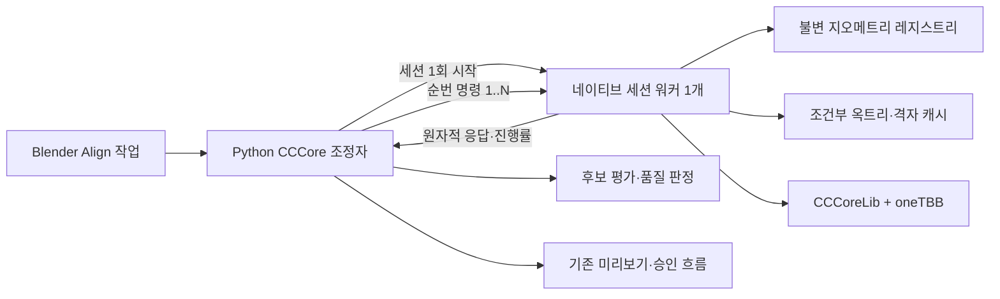

# COLMAP Align CCCoreLib 단일 세션 워커·지오메트리 캐시 구조 변경 계획서

- 작성일: 2026-09-04
- 상태: 1~5단계 구현·검증, 6단계 등록 가속 구조 성능 패치 미적용 판정과 최종 실데이터 검증 완료; 성능·수치·메모리는 통과, 프로토콜 오버헤드는 실패, Paging은 미판정, 전체는 `EXPERIMENT_ONLY`
- 대상: `codex/align-test-env` 브랜치의 독립 실험 애드온 `colmap_align_test_env`
- 소스: `E:\DEV\DEV_RND\colmap_align_test_env\source`
- 목적: 한 Align 작업에서 반복 실행되는 CCCoreLib 네이티브 프로세스를 하나의 작업 전용 세션으로 통합하고, 동일 지오메트리와 안전하게 재사용할 수 있는 가속 구조를 메모리에 유지해 전체 정렬 시간을 줄인다.
- 관련 문서: [CCCoreLib CPU 멀티스레드 적용 계획서](COLMAP_Align_CCCoreLib_CPU_멀티스레드_적용_계획서.md), [CCCoreLib 구현·검증 기록](COLMAP_Align_CCCoreLib_구현검증.md), [ADR-0010](https://github.com/hckyeong/Colmap_blender_Tools/blob/fd2d9cf57bb022505ea3b021a3bc2ee9f7f41df6/docs/decisions/0010-cccore-align-test-runtime.md)

## 1. 결정 요약

1. 서로 다른 네이티브 프로세스 사이에 CCCoreLib 객체를 공유하지 않는다. Align 작업마다 네이티브 프로세스를 하나만 실행하고, 그 프로세스 안에서 지오메트리와 캐시를 공유한다.
2. Python은 현재처럼 표본 생성, 후보 행렬 조합, 독립 품질 평가와 최종 후보 선택을 담당한다. 정렬 정책을 C++에 복제하지 않는다.
3. 표면-표면 기준 8개의 논리 연산 순서는 유지한다. 물리적인 프로세스 생성 횟수만 8회에서 1회로 줄인다.
4. A/P 기본 원본의 CCCoreLib `PointCloud`, 삼각면 인덱스와 `SimpleMesh`만 작업 종료까지 보관한다. 평가·등록 변형 점군은 명령 범위에서 재사용하고 성공 응답 기록 직후 해제한다.
5. 옥트리와 메시 교차 격자는 입력 좌표, 결합 경계 상자, 옥트리 단계와 거리 매개변수가 모두 같은 경우에만 재사용한다. 단순히 같은 메시라는 이유로 재사용하지 않는다.
6. 후보마다 변형된 메시 복사본을 만들지 않도록, 역방향 표면 거리는 기준 표본에 역행렬을 적용해 원본 이동 메시를 조회하는 방식으로 별도 검증한다.
7. 현재 레이어, 마커, Align 실행, 진행 표시, 취소, 미리보기, 승인, Undo/Redo UI는 유지한다. 새 성능 설정은 추가하지 않는다.
8. 네이티브 프로토콜과 알고리듬 식별자는 v3로 올리고, v2 실행 파일과 벤치마크 결과는 비교·폐기용 기준선으로 보존한다.
9. 단계별 시간을 먼저 계측한 뒤, 효과가 확인된 캐시만 다음 단계로 채택한다. 목표 성능을 맞추기 위해 표본 수, 반복 수나 품질 기준을 줄이지 않는다.

## 2. 현재 구조와 병목 근거

### 2.1 현재 표면-표면 실행 순서

현재 `NativeRunner.call()`은 호출할 때마다 `colmap_cccore_worker.exe --request ...`를 새로 실행한다. 표면-표면 작업은 다음 8개 연산을 순차 실행한다.

| 순번 | 논리 단계 | 네이티브 연산 | 삼각면 모델 |
| ---: | --- | --- | --- |
| 1 | Baseline 이동→기준 | 거리 | 기준 메시 |
| 2 | Baseline 기준→이동 | 거리 | 이동 메시 |
| 3 | Rigid | 등록 | 기준 메시 |
| 4 | Rigid 이동→기준 | 거리 | 기준 메시 |
| 5 | Rigid 기준→이동 | 거리 | 변형된 이동 메시 |
| 6 | Scale Refine | 등록 | 기준 메시 |
| 7 | Scale 이동→기준 | 거리 | 기준 메시 |
| 8 | Scale 기준→이동 | 거리 | 변형된 이동 메시 |

Python은 좌표와 삼각면 바이너리를 작업 폴더에 한 번 기록해 파일 경로를 재사용한다. 그러나 네이티브 프로세스가 매번 종료되므로 각 호출은 다음 작업을 다시 수행한다.

- 위치 바이너리 읽기와 `float64` 유효성 검사
- CCCoreLib `PointCloud`의 `float32` 좌표 변환·적재
- 삼각면 인덱스 읽기, 범위·중복 정점·면적 검사
- `SimpleMesh` 생성
- 거리 계산용 옥트리 단계 탐색
- 점군 옥트리와 메시 교차 격자 생성
- CCCoreLib 연산 뒤 결과 직렬화

표면-표면에서는 큰 기준 메시가 삼각면 모델로 5회, 이동 메시가 3회 적재된다. 등록은 2회이고 나머지 6회는 독립 거리 평가다.

### 2.2 실데이터 기준선

`C:\Users\gksru\Desktop\Untitled.blend`에서 v2 결과는 다음과 같다.

| 설정 | 전체 Align | 네이티브 8회 합계 | 비교 결과 |
| --- | ---: | ---: | --- |
| v2 1스레드 | 96.0219초 | 92.5135초 | 기준선 |
| v2 자동 31스레드 | 90.4438초 | 87.0021초 | 1스레드 대비 1.0617배 |

자동 31스레드의 평균 CPU 사용은 약 1.285코어였다. 짧은 구간은 병렬화됐지만, 파일 적재·삼각면 검증·옥트리와 메시 교차 격자 생성 같은 반복 준비 구간이 전체 시간을 지배했다. 따라서 스레드 수 추가보다 호출 경계와 반복 준비를 줄이는 작업이 먼저 필요하다.

### 2.3 고정 CCCoreLib API에서 확인한 경계

고정 커밋 `dc8c7d80f4ef8fd6a2c302c8d5f9c35099ba8432`의 공식 API는 다음 특성을 가진다.

- 점군-점군 거리 API는 비교·기준 점군의 미리 만든 옥트리를 선택 인자로 받는다.
- 점군-메시 거리 API는 비교 점군의 미리 만든 옥트리를 선택 인자로 받는다. 이 옥트리의 경계는 점군과 메시를 합친 동일한 정육면체 경계여야 한다.
- 점군-메시 기본 API는 호출 안에서 `GridAndMeshIntersection`을 만들고 메시와 격자의 교차를 다시 계산한다.
- `computeCloud2MeshDistancesWithOctree`는 이미 만든 옥트리와 메시 교차 격자를 받을 수 있다.
- `RegistrationTools::ICP`는 초기 옥트리 단계를 찾은 뒤 반복마다 거리 API를 호출하지만, 외부에서 옥트리나 메시 교차 격자 캐시를 주입하는 공개 인자가 없다.

근거: [고정 `DistanceComputationTools.h`](https://github.com/CloudCompare/CCCoreLib/blob/dc8c7d80f4ef8fd6a2c302c8d5f9c35099ba8432/include/DistanceComputationTools.h), [고정 `DistanceComputationTools.cpp`](https://github.com/CloudCompare/CCCoreLib/blob/dc8c7d80f4ef8fd6a2c302c8d5f9c35099ba8432/src/DistanceComputationTools.cpp), [고정 `RegistrationTools.cpp`](https://github.com/CloudCompare/CCCoreLib/blob/dc8c7d80f4ef8fd6a2c302c8d5f9c35099ba8432/src/RegistrationTools.cpp)

이 경계 때문에 프로세스를 하나로 합치는 것만으로 지오메트리 적재는 확실히 재사용할 수 있지만, 모든 옥트리와 메시 교차 격자가 자동으로 재사용되지는 않는다.

## 3. 목표와 범위

### 3.1 포함

- Align 작업당 네이티브 세션 프로세스 1개
- 명령 순번이 있는 파일 기반 세션 프로토콜
- 작업 내부의 불변 지오메트리 레지스트리
- `PointCloud`와 `SimpleMesh`의 1회 적재·검증
- 현재 4개 입력 조합의 논리 연산 순서 유지
- 단계별 적재·검증·가속 구조·커널·직렬화 시간 계측
- 조건이 정확히 일치하는 옥트리와 메시 교차 격자 재사용
- 역방향 표면 거리의 원본 메시 고정 방식 검증
- 정확히 같은 후보 평가의 선택적 결과 재사용 검토
- 현재 oneTBB 스레드 상한, 취소와 Windows Job Object 수명 관리 유지
- v2 대비 수치·UX·패키징·성능·메모리 회귀 검증

### 3.2 제외

- 서로 다른 Align 작업 또는 Blender 세션 사이의 전역 캐시
- OS 공유 메모리에 CCCoreLib 객체를 직렬화하는 방식
- GPU/CUDA 가속
- 표본 수, ICP 반복 수, 겹침 비율, ±10퍼센트 배율과 품질 판정 변경
- 자동 엔진 전환이나 실패 시 조용한 v2 재실행
- COLMAP·OBJ 원본, 내장 원본 토폴로지와 Export 정책 변경
- 레이어·마커·Align 패널의 사용자 조작 변경
- `main` 브랜치 통합

## 4. 목표 구조



Blender가 실행하는 외부 Python 작업자는 그대로 유지한다. Python 작업자가 자식 네이티브 프로세스를 한 번 시작하고, Rigid·Scale 등록과 후보 거리 평가를 순서대로 요청한다. 세션은 해당 Align 작업에만 속하며 성공, 취소 또는 실패 때 반드시 종료된다.

이 방식은 OS 공유 메모리보다 안전하다. CCCoreLib의 `PointCloud`, `SimpleMesh`, `DgmOctree`와 교차 격자는 내부 포인터와 소유 객체의 수명에 의존하므로 다른 주소 공간에서 그대로 사용할 수 없다. 한 프로세스 안에 두면 기존 객체 수명 규칙을 유지하면서 실제 객체를 재사용할 수 있다.

## 5. 세션 프로토콜

### 5.1 파일 배치

작업 폴더 아래에 다음 파일만 사용한다.

```text
native/
  session.request.json
  session.ready.json
  commands/0001.request.json
  responses/0001.result.json
  progress.json
  geometry/*.bin
cancel.request
```

- Python은 `session.request.json`을 완성한 뒤 원자적으로 이름을 바꾼다.
- 워커는 `--session <절대경로>`로 한 번 실행한다.
- 워커가 런타임 식별자와 스레드 설정을 검사한 뒤 `session.ready.json`을 원자적으로 확정한다.
- 각 명령은 1부터 증가하는 순번, 세션 ID, 작업 ID와 요청 지문을 가진다.
- 워커는 직전 명령을 완료하고 응답 파일을 확정한 뒤에만 다음 순번을 실행한다.
- 누락, 중복, 역순, 이미 처리한 순번의 내용 변경은 프로토콜 오류로 세션 전체를 종료한다.
- 표준 입출력은 계약으로 사용하지 않는다. 현재처럼 파이프 정체와 로그 의존성을 만들지 않고, 기존 작업 폴더·경로 검증·취소 파일 방식을 유지한다.

명령 수가 최대 8회 안팎이므로 JSON 파일 폴링 비용은 정렬 시간에 비해 작다. 지오메트리 본문은 명령 JSON에 넣지 않고 기존 바이너리를 최초 적재할 때만 읽는다.

### 5.2 명령 종류

| 명령 | 역할 |
| --- | --- |
| `LOAD_GEOMETRY` | 작업 내부 ID에 좌표·삼각면 파일을 결합하고 한 번 검증·적재한다. |
| `REGISTER` | 등록 데이터 ID, 모델 ID, 사전 변환과 현재 파라미터로 Rigid 또는 Scale 등록을 수행한다. |
| `DISTANCE` | 평가 표본 ID, 대상 ID, 방향과 사전 변환으로 독립 거리를 계산한다. |
| `CLOSE` | 마지막 응답 순번을 확인하고 캐시 통계를 확정한 뒤 정상 종료한다. |

첫 단계에서는 현재 Python이 만드는 변형 좌표 파일도 각각 별도 지오메트리 ID로 적재해 v2 계산 순서를 그대로 보존한다. 수치 동등성을 통과한 뒤에만 명령의 사전 변환을 사용해 중간 파일과 변형 메시 복사본을 줄인다.

### 5.3 세션 수명

1. Python이 실행 파일, DLL과 Runtime Manifest 식별자를 검사한다.
2. 세션 요청을 기록하고 네이티브 워커를 한 번 실행한다.
3. 즉시 Windows Job Object에 연결하고 `JOB_OBJECT_LIMIT_KILL_ON_JOB_CLOSE` 정책을 유지한다.
4. `session.ready.json`의 프로토콜, 코어 커밋, 패치, oneTBB 버전과 실제 스레드 수를 검증한다.
5. 지오메트리를 적재하고 형상 모드별 고정 순서로 등록·거리 명령을 실행한다.
6. Python이 각 응답을 검증하고 현재 방식으로 후보 행렬과 품질 지표를 계산한다.
7. `CLOSE` 응답과 세션 통계를 받은 뒤 프로세스의 정상 종료를 기다린다.
8. 실행 파일과 Runtime Manifest 식별자를 다시 확인한 후에만 최종 결과를 확정한다.
9. 어느 단계에서든 예외·취소·프로토콜 위반이 발생하면 세션 결과 전체를 폐기하고 자식 프로세스를 종료한다.

Windows Job Object는 프로세스 묶음의 수명과 자원을 하나로 관리하고, `JOB_OBJECT_LIMIT_KILL_ON_JOB_CLOSE`일 때 마지막 핸들이 닫히면 연결된 프로세스를 종료한다. 현재 자식 회수 계약을 세션 전체에 그대로 적용한다. [Microsoft Job Objects](https://learn.microsoft.com/en-us/windows/win32/procthread/job-objects)

## 6. 지오메트리 레지스트리

### 6.1 저장 객체

세션은 형상별로 다음 객체를 소유한다.

- 작업에서 받은 삼각면 인덱스와 형상 설명
- CCCoreLib 연산용 `float32 PointCloud`
- 메시일 때 원본 삼각면 연결을 가리키는 `SimpleMesh`
- 반복 변환이 필요한 등록·평가 표본의 작은 `float64` 원본 배열
- 바운딩 박스, 점·삼각면 수와 형상 종류
- 작업 입력 지문, 모델 ID·Revision, 정규화 지문과 역할
- 실제 적재·변환·검증에 든 시간과 추정 메모리

`SimpleMesh`가 참조하는 `PointCloud`는 메시보다 먼저 파기하지 않는다. 캐시는 세션의 단일 소유 객체가 역순으로 정리한다.

대형 메시 좌표는 `float64` 입력을 검사하면서 `float32 PointCloud`로 변환한 뒤 임시 읽기 버퍼를 해제한다. 대형 메시의 `float64`·`float32` 전체 복사본을 동시에 장기 보관하지 않는다. 후보 변환에는 전체 메시가 아니라 고정 평가·등록 표본의 `float64` 배열만 사용한다.

### 6.2 키와 불변성

표시용 레이블이나 파일 경로만 캐시 키로 쓰지 않는다. 지오메트리 토큰은 다음 작은 메타데이터의 정규 표현으로 만든다.

```text
작업 입력 지문
+ 모델 ID와 Revision
+ 역할
+ 좌표계·정규화 지문
+ 점·삼각면 수와 자료형
+ 작업 내부 바이너리 경로
```

사용자 원본 OBJ 전체를 다시 SHA-256 검사하지 않는다. 기존 작업 준비 단계가 확정한 입력 지문과 작업 전용 디렉터리를 신뢰 경계로 사용한다. 같은 토큰이 다른 경로, 크기 또는 형상 설명으로 다시 선언되면 세션을 실패시킨다. 메모리에 적재된 객체는 수정하지 않고, 변형이 필요한 데이터는 별도 임시 점군으로 만든다.

### 6.3 기대 적재 횟수

| 형상 모드 | 메시 기본 객체 적재 | 점군 기본 객체 적재 | 네이티브 프로세스 |
| --- | ---: | ---: | ---: |
| 점군-점군 | 0 | A/P 각 1회와 고정 표본 | 1 |
| 점군-표면 | 기준 메시 1회 | 이동 점군과 표본 1회 | 1 |
| 표면-점군 | 이동 메시 1회 | 기준 점군과 표본 1회 | 1 |
| 표면-표면 | A/P 메시 각 1회 | 고정 평가·등록 표본 | 1 |

1단계의 수치 보존 구현에서는 후보별 변형 메시가 별도 객체로 남을 수 있다. 3단계의 역방향 거리 변환이 통과하면 이 객체를 제거해 A/P 원본 메시만 유지한다.

## 7. 형상 모드별 논리 연산 계약

세션화 뒤에도 v2와 같은 논리 순서를 검증한다.

| 형상 모드 | 논리 연산 수 | 순서 |
| --- | ---: | --- |
| 점군-점군 | 6 | 간격 거리, Baseline 거리, Rigid 등록·거리, Scale 등록·거리 |
| 점군-표면 | 5 | Baseline 거리, Rigid 등록·거리, Scale 등록·거리 |
| 표면-점군 | 5 | Baseline 역방향 거리, Rigid 역등록·거리, Scale 역등록·거리 |
| 표면-표면 | 8 | Baseline 양방향 거리, Rigid 등록·양방향 거리, Scale 등록·양방향 거리 |

`native_calls`는 v3에서 `logical_operations`로 명확히 구분하고, 각 항목에 명령 순번, 연산, 단계, 실행 시간과 캐시 사용 여부를 기록한다. 실제 프로세스 수는 별도 `native_process_count=1`로 검증한다. v2 결과를 읽는 호환 경로는 기존 `native_calls`를 그대로 해석한다.

## 8. 변형 메시 복사 제거

### 8.1 이동→기준 방향

기준 메시나 점군은 고정하고, 이동 평가 표본에 후보 행렬을 적용한다. 전체 이동 메시를 변형할 필요가 없다.

### 8.2 기준→이동 표면 방향

후보 행렬을 `T(x) = sRx + t`, `s > 0`인 유사변환이라고 하면 다음 관계가 성립한다.

```text
distance(q, T(M)) = s × distance(T⁻¹(q), M)
```

따라서 현재처럼 후보마다 이동 메시 전체를 변형해 모델로 만들지 않고 다음 순서를 사용할 수 있다.

1. 기준 평가 표본 `q`에 후보 역행렬을 `float64`로 적용한다.
2. 불변 원본 이동 메시 `M`에 대한 거리를 계산한다.
3. 반환 거리에 검증된 양의 균일 배율 `s`를 곱해 정규화 공간의 거리로 복원한다.

이 최적화는 반사, 전단, 비균일 배율을 허용하지 않는다. 기존 `matrix_sim3` 검증을 먼저 통과한 행렬만 사용한다. 변환 순서와 `float64 → float32` 반올림 차이 때문에 1단계 세션화와 분리해 네 형상 조합의 수치 동등성을 확인한 뒤 채택한다.

## 9. 가속 구조 재사용 수준

### 9.1 수준 0: 단계별 계측

v2와 v3 모두 다음 시간을 분리 기록한다.

- 프로세스 시작·준비
- 바이너리 읽기
- 좌표 변환과 유효성 검사
- 삼각면 검사와 `SimpleMesh` 생성
- 옥트리 단계 선택
- 점군 옥트리 생성
- 메시 교차 격자 생성
- CCCoreLib 등록·거리 커널
- 결과 복사와 파일 직렬화

계측 오버헤드는 대표 입력 전체 시간의 1퍼센트 이하인지 확인한다. 이 자료 없이 CCCoreLib 내부를 패치하지 않는다.

### 9.2 수준 1: 지오메트리 캐시

첫 채택 범위다. 같은 지오메트리 토큰은 `PointCloud`와 `SimpleMesh`를 한 번만 만든다. 기준 메시의 5회 적재와 검증을 1회로 줄이는 것이 표면-표면의 우선 목표다.

### 9.3 수준 2: 공개 API 옥트리 재사용

- 점군-점군: 두 옥트리의 정육면체 경계가 완전히 같을 때만 `computeCloud2CloudDistances`의 선택 인자로 전달한다.
- 점군-메시: 비교 점군 옥트리의 경계가 점군과 메시의 결합 정육면체 경계와 완전히 같을 때만 `computeCloud2MeshDistances`에 전달한다.
- 캐시 키에는 두 형상 토큰, 적용 변환의 정규 바이트, 정육면체 최소·최대, 옥트리 단계와 거리 정책 버전을 포함한다.
- 조건이 다르면 새로 만들고 `cache_miss_reason`을 기록한다. 오래된 옥트리를 억지로 재사용하지 않는다.

현재 워커는 점군-메시의 최적 단계를 찾으려고 데이터·모델 옥트리를 만든 뒤, 데이터 옥트리를 거리 API에 넘기지 않아 내부에서 다시 생성한다. v3에서는 현행 단계 선택 결과를 먼저 고정하고, 동일한 결합 경계로 만든 옥트리를 공개 API에 전달했을 때 중복 생성이 없어지는지 검증한다. 단계 선택이나 거리 결과가 바뀌면 이 최적화는 채택하지 않는다.

### 9.4 수준 3: 메시 교차 격자 재사용

공개 `computeCloud2MeshDistancesWithOctree`를 사용해 다음 키가 모두 같은 거리 평가에서만 `GridAndMeshIntersection`을 재사용한다.

```text
메시 토큰
+ 결합 정육면체 경계
+ 셀 크기와 옥트리 단계
+ 거리 맵·부호·강건성 관련 파라미터
+ 고정 CCCoreLib 커밋·패치 ID
```

후보 변환으로 평가점 경계가 달라지면 결합 경계와 셀 크기도 달라질 수 있으므로 캐시 적중으로 간주하지 않는다. 여러 후보 평가를 공통 경계로 묶는 최적화는 거리 수치와 진행 단계 동등성을 별도 실험한 뒤에만 채택한다.

### 9.5 수준 4: 등록 내부 재사용

`RegistrationTools::ICP`는 외부 캐시를 받지 않고 반복 중 이동 점군이 계속 바뀐다. 다음 조건을 모두 만족할 때만 고정 CCCoreLib에 최소 패치를 추가한다.

1. 계측에서 등록 내부의 반복 옥트리·격자 생성이 남은 전체 시간의 주요 병목으로 확인된다.
2. 공개 API 조합만으로 같은 결과를 만들 수 없다는 근거를 남긴다.
3. 정렬 루프를 워커에 다시 구현하지 않고, 기존 `RegistrationTools::ICP`에 제한된 캐시 입력 경계만 추가한다.
4. 원본·패치 SHA-256, Patch ID, 라이선스와 재빌드 원문 ZIP을 갱신한다.
5. v2 대비 네 형상 조합과 배율 경계의 수치 동등성을 통과한다.

등록 반복에서는 변형된 데이터와 결합 경계가 달라질 수 있으므로 모델이 같다는 이유만으로 교차 격자를 유지하지 않는다.

## 10. 정확히 같은 후보의 평가 재사용

세션화와 별도로, 후보 변화량이 정확히 같은 경우 같은 독립 거리 결과를 다시 계산하지 않는 최적화를 검토한다. `Untitled.blend` 벤치마크에서는 Baseline, Rigid와 Scale 후보가 모두 항등 행렬이어서 후보 거리 4회를 생략할 수 있는 상태였다.

재사용 키는 다음 값의 정규 바이트가 모두 같을 때만 적중한다.

- 이동·기준 지오메트리 토큰
- 평가 표본 토큰과 방향
- 후보 `float64` 4×4 행렬
- 정규화 지문
- 거리·품질 정책 버전
- 형상 모드와 CCCoreLib 알고리듬 버전

행렬 근사 비교는 사용하지 않는다. 캐시 적중 시에도 논리 연산 항목은 남기고 `execution_source=exact_evaluation_cache`와 원본 명령 순번을 기록한다. 이 최적화는 이미 정렬된 데이터에는 큰 효과가 있지만 실제로 다른 Rigid·Scale 후보가 나온 작업에는 적용되지 않으므로, 단일 세션 워커의 성능과 분리해 보고한다.

## 11. 메모리 정책

프로세스 1회 구조는 반복 파일 I/O를 줄이는 대신 A/P 지오메트리를 동시에 보관한다. 다음 규칙으로 피크 메모리를 제한한다.

- 원본 메시 캐시는 A/P당 하나만 유지한다.
- 대형 메시의 임시 `float64` 읽기 버퍼는 `float32 PointCloud` 변환 직후 해제한다.
- 후보별 전체 변형 메시를 장기 캐시하지 않는다.
- 평가·등록용 변형 점군은 현재 명령이 끝나면 해제한다. 다시 필요한 불변 표본만 유지한다.
- 옥트리와 교차 격자는 실제 추정 바이트를 기록하고, 작업 시작 시 정한 캐시 예산 안에서만 보관한다.
- 예산을 넘으면 가장 오래 사용하지 않은 가속 구조만 해제한다. 지오메트리 기본 객체는 세션 종료까지 유지한다.
- 가속 구조 캐시 미채택은 같은 CCCoreLib 계산을 새로 수행하는 정상 경로이며 결과 정책을 바꾸지 않는다.
- 세션 종료 시 캐시 객체가 모두 해제됐는지 프로세스 종료와 핸들 수로 확인한다.

새 UI 설정은 만들지 않는다. 먼저 실제 지오메트리·옥트리·격자 크기를 계측하고, 자동 예산 규칙은 실데이터 결과를 근거로 확정한다.

## 12. 진행률·취소·실패 계약

### 12.1 진행률

- 외부 진행 단계 `PREPARING`, `BASELINE`, `RIGID`, `RIGID_EVALUATION`, `SCALE_REFINE`, `REFINE_EVALUATION`, `FINALIZING`은 유지한다.
- 네이티브 보조 진행에는 현재 명령 순번과 `LOAD`, `VALIDATE`, `OCTREE`, `MESH_GRID`, `KERNEL`, `SERIALIZE` 하위 단계를 추가한다.
- 캐시 적중 단계는 완료로 건너뛰되 가짜 계산 진행률을 만들지 않는다.

### 12.2 취소

- Python은 기존 `cancel.request`를 사용한다.
- 워커는 명령 대기 중, 적재 전후, 가속 구조 생성 전후와 CCCoreLib 진행 콜백에서 취소를 확인한다.
- 정상 취소 응답을 기다리는 시간은 현재처럼 최대 2초다. 이후 Python이 세션 프로세스를 종료하고 Job Object로 자원을 회수한다.
- 취소된 세션의 부분 응답, 거리 바이너리와 캐시는 최종 결과로 인정하지 않는다.

### 12.3 충돌과 프로토콜 오류

- 워커 충돌, 응답 손상, 순번 불일치, 잘못된 캐시 ID와 런타임 식별자 변경은 해당 Align 작업 전체 실패다.
- 충돌 뒤 같은 세션 디렉터리에 재연결하지 않는다. 메모리 캐시 상태를 증명할 수 없기 때문이다.
- v2 다중 프로세스 방식이나 다른 엔진으로 자동 재실행하지 않는다.
- 오류 결과는 현재 한국어 사용자 메시지와 진단 코드로 전달하고, 미리보기 행렬은 만들지 않는다.

## 13. 버전과 결과 메타데이터

새 작업은 다음 식별자를 사용한다.

```text
CC_ALGORITHM_VERSION = cccore-icp-v3
CC_JOB_PROTOCOL_VERSION = cccore-job-v3
CC_NATIVE_PROTOCOL_VERSION = cccore-native-v3
```

프로젝트 저장 스키마 8의 정렬 결과 형식은 유지하고, 세션 진단을 기존 CCCoreLib 출처 메타데이터에 추가한다. 이전 `cccore-icp-v1`과 v2 출처는 계속 읽되 새 계산에 사용하지 않는다.

추가 메타데이터는 다음과 같다.

- `native_process_count`
- `logical_operations`, `physical_native_calls`, `physical_native_command_count`
- `session_elapsed_seconds`
- 물리 명령별 `roundtrip_seconds`, `protocol_overhead_seconds`
- `session_protocol_statistics`와 최상위 `physical_roundtrip_seconds`, `protocol_overhead_seconds`, `protocol_overhead_ratio_of_roundtrip`, `protocol_overhead_fraction_of_total_alignment`
- `geometry_load_count`, `geometry_cache_hits`
- 형상별 `binary_read_seconds`, `conversion_seconds`, `validation_seconds`
- `octree_build_count`, `octree_cache_hits`
- `mesh_grid_build_count`, `mesh_grid_cache_hits`
- 명령별 `kernel_seconds`, `serialization_seconds`
- `peak_working_set_bytes`, `cache_peak_estimated_bytes`
- `session_exit_reason`

각 논리 연산은 연산 종류, 단계, 명령 순번, 실행 출처, 실제 스레드 수, 경과 시간과 사용한 지오메트리·가속 구조 토큰을 기록한다. 물리 명령 왕복 시간은 Python이 요청 파일 원자 기록 직전부터 응답과 거리·행렬 검증 완료 직후까지 단조 시계로 측정한다. 프로토콜 오버헤드는 `max(0, roundtrip_seconds - native elapsed_seconds)`이며, 전체 비율은 물리 명령 오버헤드 합계를 최종 solver `elapsed_seconds`로 나눈 값이다. 정확 캐시 논리 기록은 원본 물리 측정값을 복제하지만 합계에는 원본 물리 명령을 한 번만 포함한다. 공통 계약과 Blender runtime은 명령별 공식, 물리 합계, 중첩·최상위 중복 값과 전체 시간 비율을 재계산해 검증한다. 새 프로토콜 계측 필드에는 원본 경로·전체 좌표를 추가 복제하지 않는다. 기존 provenance의 `source_path` 계약은 유지한다.

## 14. UI와 사용자 동작

- Add-on Preferences의 `CPU 스레드`와 `CC 정렬 환경 검사`는 그대로 사용한다.
- 레이어의 점군·표면 선택, 마커 쌍, 3점 초기 정렬과 Align 버튼 동작을 바꾸지 않는다.
- 실행 중 취소 버튼, 미리보기, 버리기·승인, 승인 뒤 A 편입과 Undo/Redo를 유지한다.
- 완료 화면에 캐시 행을 상시 추가하지 않는다. 자세한 시간과 적중 정보는 결과 출처와 실험 보고서에 기록한다.
- 환경 검사는 v3 세션 지원, 프로토콜 버전, oneTBB와 기본 세션 시작·종료 검사를 추가한다.

## 15. 파일별 변경 계획

새로 만들거나 수정하는 함수에는 기능을 설명하는 한 줄 내외의 한국어 주석 또는 문서화 문자열을 둔다. 성능 계측용 임시 콘솔 로그는 검증이 끝나면 제거하고, 최종 결과 계약에 정의한 구조화 시간 정보만 남긴다.

| 파일 | 계획 |
| --- | --- |
| `tools/align/alignment/icp_cccore_contract.py` | v3 식별자, 세션·명령·응답, 지오메트리 토큰과 논리 연산 요약의 엄격한 검증 추가 |
| `tools/align/alignment/icp_cccore_solver.py` | `NativeRunner`를 작업 전용 `NativeSessionRunner`로 변경하고 1회 시작·순차 명령·종료·캐시 통계를 연결 |
| `tools/align/alignment/icp_cccore_runtime.py` | v3 환경 검사, 결과 메타데이터와 이전 v1/v2 출처 읽기 호환 연결 |
| `tools/align/alignment/icp_solver_backend.py` | CCCoreLib 새 작업 알고리듬 식별자를 v3로 갱신 |
| `tools/align/native/cccore_worker/main.cpp` | `--session` 진입점, 순번 명령 루프, 지오메트리 레지스트리, 단계 계측·취소·원자 응답과 정상 종료 추가 |
| `tools/align/native/cccore_worker/CMakeLists.txt` | 필요한 경우 세션·캐시 구현 파일을 빌드에 추가하고 기존 oneTBB 필수 계약 유지 |
| `tools/align/native/cccore_worker/dependencies.lock.json` | v3 프로토콜과 새 패치가 있을 때만 Patch ID·해시 갱신 |
| `build_tools/prepare_cccore_runtime.ps1` | v3 실행 파일 빌드, Manifest·원문 ZIP·오프라인 재빌드 검증 갱신 |
| `tools/align/native/cccore_worker/README.md` | 세션 명령, 객체 수명, 캐시 키, 결과·오류 계약 문서화 |
| `tools/align/native/cccore_worker/REBUILD.md` | v3 재현 빌드와 설치 런타임 검증 절차 추가 |
| `tests/align/native/test_cccore_worker.py` | 세션 순서, 1회 적재, 캐시 조건, 충돌·취소·종료와 네 형상 조합 검사 |
| `tests/align/test_icp_cccore_solver.py` | 프로세스 1개, v2 논리 순서·행렬·지표 동등성, 역방향 거리와 정확 평가 캐시 검사 |
| `tests/align/blender/test_icp_cccore_runtime.py` | v3 출처 복원, 이전 결과 호환, 취소·미리보기·승인 회귀 검사 |
| `tests/align/blender/test_icp_cccore_ui.py` | 기존 Preferences와 Align UI 배치·동작 불변 검사 |
| `test_env/cccore_checks.py` | 설치본 세션 시작·종료, 네 형상 조합과 캐시 통계 검사 |
| `test_env/manage.py` | v3 Runtime Manifest·패키징·잔류 프로세스 검증 추가 |
| `docs/TESTING.md` | v2/v3 단계별 성능·메모리 비교 명령과 결과 위치 추가 |
| `docs/decisions/0010-cccore-align-test-runtime.md` | 구현·검증 완료 뒤 작업당 단일 네이티브 세션 결정을 기록 |

## 16. 구현 순서

### 1단계: v2 내부 시간 기준선 계측

1. 현재 v2 계산 결과를 바꾸지 않고 네이티브 내부 세부 시간을 기록한다.
2. `Untitled.blend`를 1스레드와 자동 31스레드로 각각 3회 측정한다.
3. 큰 메시 적재, 삼각면 검증, 옥트리, 메시 격자와 커널 비중을 확정한다.
4. 기존 v2 실행 파일·DLL·Manifest 해시와 결과를 기준 보고서에 고정한다.

### 2단계: 단일 세션과 지오메트리 1회 적재

1. v3 파일 세션 프로토콜과 엄격한 순번 검증을 구현한다.
2. Python이 네이티브 워커를 작업당 한 번만 시작하도록 바꾼다.
3. 현재 변형 좌표 생성과 8개 논리 연산은 그대로 유지한다.
4. 동일 토큰의 `PointCloud`와 `SimpleMesh`를 한 번만 만들고 재사용한다.
5. 성공·오류·취소 모든 경로에서 세션 프로세스와 핸들을 회수한다.
6. v2와 행렬·거리·후보·품질이 동등한지 확인한다.

### 3단계: 불변 메시와 변환 참조

1. 평가·등록 명령이 기본 지오메트리 ID와 사전 변환을 참조하게 한다.
2. 기존과 같은 `float64` 변환 뒤 `float32` 적재 순서를 보존한다.
3. 역방향 표면 거리에 `distance(q, T(M))` 변환 공식을 적용한다.
4. 후보별 전체 변형 메시의 파일 기록·적재·장기 보관을 제거한다.
5. 모든 형상 모드와 ±10퍼센트 경계에서 v2 동등성을 재검증한다.

### 4단계: 공개 API 가속 구조 캐시

1. 현재 중복되는 점군-메시 데이터 옥트리 생성을 먼저 제거한다.
2. 완전한 결합 경계·단계·파라미터 키로 C2C/C2M 옥트리를 캐시한다.
3. 동일 키가 실제 반복되는 경우에만 메시 교차 격자를 캐시한다.
4. 캐시 적중·실패 원인과 메모리를 결과에 기록한다.
5. 캐시 유무의 거리 배열과 최종 결과가 동등한지 확인한다.

### 5단계: 정확 후보 평가 캐시

1. 완전히 같은 후보 행렬과 평가 계약만 탐지한다.
2. 이미 계산한 방향별 거리·요약을 재사용하고 논리 연산 기록은 유지한다.
3. 항등 후보와 실제 오정렬 후보에서 적중·미적중 동작을 각각 검증한다.
4. 세션 성능과 후보 캐시 성능을 분리해 보고한다.

### 6단계: 등록 내부 패치 여부 결정

1. 2~5단계 뒤 남은 병목을 다시 측정한다.
2. 등록 내부 가속 구조 생성이 주요 병목일 때만 최소 CCCoreLib 패치를 설계한다.
3. 패치가 수치·메모리·취소 기준을 통과하지 못하면 적용하지 않는다.

### 7단계: 설치본과 실제 Blender 검증

1. 격리 설치본을 새로 스테이징하고 환경 검사를 실행한다.
2. 네 형상 조합, 마커 초기값, 미리보기·승인·Undo/Redo와 OBJ Export를 검사한다.
3. `Untitled.blend`와 의도적으로 오정렬한 메모리 복사본으로 성능을 측정한다.
4. 원본 `.blend`, COLMAP과 OBJ 파일의 크기·해시·mtime이 바뀌지 않았는지 확인한다.
5. 실험 결과가 채택 기준을 통과한 뒤에만 통합 후보 커밋으로 정리한다.

## 17. 검증 항목

### 17.1 프로토콜·수명

- Align 작업당 네이티브 PID가 정확히 1개
- 세션 Ready 전 명령, 누락·중복·역순 순번과 다른 세션 ID 거부
- 명령·응답 임시 파일을 부분 JSON으로 읽지 않음
- 알 수 없는 지오메트리 ID와 같은 토큰의 다른 설명 거부
- 절대·상위·심볼릭 링크 경로 탈출과 과도한 파일 크기 거부
- 워커 충돌 뒤 부분 결과 미수용과 재연결 금지
- 정상·오류·취소 뒤 잔류 프로세스, Job Object 핸들, 잠긴 파일 없음
- 실행 파일·DLL·Manifest 변경 감지

### 17.2 지오메트리·캐시

- 표면-표면에서 A/P 기본 메시 각각 1회 적재·검증
- 점군-표면과 표면-점군에서 대상 메시 1회 적재·검증
- 캐시 키의 좌표계, Revision, 변환, 경계, 단계와 파라미터 변경 시 미적중
- 다른 작업 ID 사이에 캐시가 남지 않음
- `SimpleMesh`보다 연결 `PointCloud`가 오래 유지됨
- 캐시 예산 초과 시 가속 구조만 회수하고 결과는 동일함
- 캐시 통계 합계가 실제 생성·적중 횟수와 일치함

### 17.3 수치·알고리듬

- 점군-점군, 점군-표면, 표면-점군, 표면-표면의 v2/v3 비교
- 1스레드와 자동 31스레드 비교
- Rigid, Scale Refine, ±10퍼센트 상·하한과 역방향 등록
- Baseline·후보별 방향 거리 배열, RMS·Median·P95·절단 RMS·공간 구간 비교
- 최종 행렬, 후보 이름, 품질, 검토 이유와 Stop Reason 비교
- 역방향 유사변환 거리 공식의 무작위 양의 배율·회전·이동 검증
- 반사·전단·비균일·비유한 행렬 거부
- 정확 후보 캐시가 근사 행렬을 같은 후보로 취급하지 않음

### 17.4 UX·회귀

- 기존 레이어·점군·표면 아이콘과 마커 쌍 지정 동작
- 3점 초기 정렬과 CC 정밀 정렬 연결
- 기존 진행 단계와 한국어 메시
- 작업 중 취소와 2초 강제 종료
- 미리보기 버리기·승인, 승인 뒤 A 편입과 Undo/Redo
- COLMAP 카메라·점군, OBJ 축과 Export 행렬 불변
- Triangle·Quad·N-gon 내장 원본 토폴로지 보존
- 외부 원본 OBJ가 없는 `.blend` 복원·Export

### 17.5 패키징

- v3 실행 파일, CCCoreLib·oneTBB DLL과 라이선스 포함
- 개발 Cache 절대경로 부재
- Runtime Manifest의 실행 파일·DLL·원문 ZIP SHA-256 일치
- 고정 소스와 패치만으로 네트워크 없는 Release 재빌드 성공
- 실험 Blender 재실행 뒤 환경 검사와 세션 왕복 성공

## 18. 벤치마크와 채택 기준

### 18.1 입력

1. 기존 `Untitled.blend`: 이미 정렬된 후보와 정확 평가 캐시 효과 확인
2. 같은 파일의 메모리 내 오정렬 복사본: 서로 다른 Rigid·Scale 후보의 실제 세션·가속 구조 효과 확인
3. 작은 합성 입력 4종: 고정 오버헤드와 모든 형상 모드 확인
4. 사용자 대형 RC OBJ/COLMAP: 실제 피크 메모리와 장시간 취소 확인

원본 `Untitled.blend`는 저장하거나 덮어쓰지 않는다.

### 18.2 비교군

- v2 1스레드
- v2 자동 31스레드
- v3 세션 1스레드
- v3 세션 자동 31스레드
- v3 세션 자동 31스레드 + 공개 API 가속 구조 캐시
- 정확 후보가 같은 입력에 한해 평가 캐시 포함·제외

각 조합은 첫 실행 1회와 측정 3회를 분리한다. v3 캐시는 작업 범위이므로 새 Align 작업은 항상 Cold Start이며, 한 작업 내부의 최초 생성과 후속 적중을 별도 기록한다.

### 18.3 정확도 기준

- 프로세스 구조만 바꾼 2단계는 v2와 거리 배열·행렬·후보·품질이 동일해야 한다.
- 변환 참조와 공개 API 캐시는 기존 허용 오차 안에서 동등해야 하며 후보·품질 판정은 같아야 한다.
- 허용 오차 경계에서 후보가 달라지면 성능과 무관하게 해당 최적화를 채택하지 않는다.
- 정확 후보 캐시는 재계산 결과와 동일한 직렬화 값을 반환해야 한다.

### 18.4 성능·메모리 기준

- 표면-표면의 기본 A/P 메시 적재·삼각면 검증 횟수가 각각 1회여야 한다.
- `Untitled.blend` v3 자동 전체 시간이 v2 자동 90.4438초보다 최소 1.25배 빨라야 통합 성능 기준을 통과한다.
- 오정렬 입력에서도 정확 후보 캐시를 제외한 v3 세션이 v2 자동보다 빨라야 한다.
- v3 자동 피크 Working Set은 같은 입력의 v2 자동 893,095,936바이트 대비 15퍼센트 이내 증가를 목표로 하고 Paging이 없어야 한다.
- 진행률 반응이 멈추지 않고 취소 요청 뒤 최대 2초 안에 자식 프로세스를 회수해야 한다.
- 세션 프로토콜 자체의 명령 왕복 오버헤드는 전체 시간의 1퍼센트 이하여야 한다.

1.25배 기준을 못 채우면 결과를 실패로 숨기지 않고 단계별 병목을 문서에 남긴다. 수치·안정성은 통과했지만 성능 기준만 미달하면 v3는 실험 브랜치에 유지하고 `main`에 통합하지 않는다.

## 19. 완료 기준

1. 한 Align 작업이 네이티브 프로세스 하나로 완료된다.
2. 네 형상 조합의 논리 연산 순서와 Python 후보·품질 판정이 유지된다.
3. 동일 기본 메시와 점군은 세션에서 한 번만 읽고 검증한다.
4. 옥트리와 메시 교차 격자는 완전한 의존 키가 일치할 때만 재사용된다.
5. 후보별 전체 변형 메시가 장기 메모리와 디스크에 남지 않는다.
6. v2 대비 수치·배율·품질·축·Export 회귀가 없다.
7. 취소·충돌·프로토콜 오류 뒤 잔류 프로세스와 부분 결과가 없다.
8. 단계별 시간, 캐시 적중과 피크 메모리가 결과에 남는다.
9. 설치 패키지가 v3 런타임과 재현 가능한 원문·해시·라이선스를 포함한다.
10. 기존 레이어·마커·Align·미리보기·승인·Undo/Redo UX가 유지된다.
11. 대표 실데이터가 정한 성능·메모리 채택 기준을 통과한다.
12. 변경은 `codex/align-test-env`에만 남고 `main`과 사용자 원본 파일을 수정하지 않는다.

## 20. 폐기와 복귀

- v3는 별도 커밋 묶음으로 구현해 단일 세션, 변환 참조, 가속 구조, 정확 평가 캐시 단계를 각각 되돌릴 수 있게 한다.
- v2 실행 파일, Runtime Manifest와 벤치마크 결과를 실험 출력에 보존한다.
- v3 워커는 v2 요청을 받지 않고, v2 워커도 v3 세션을 받지 않게 해 혼용을 즉시 거부한다.
- 실험 결과가 만족스럽지 않으면 `codex/align-test-env`의 v3 관련 커밋만 폐기한다.
- `main` 통합은 수치·안정성·성능 기준과 사용자 실제 RC 결과 확인 뒤 별도 작업으로 수행한다.

## 21. 구현·단계별 판정

2026-09-05 기준 1~3단계와 5단계를 채택했다. Align당 네이티브 프로세스는 하나이며 Python이 기존 후보 조합·독립 평가·선택 순서를 유지한다. 기본 A/P geometry는 `SESSION`, 변형 평가·등록 geometry는 `COMMAND` 범위로 선언한다. 명령 응답을 원자 기록한 뒤 COMMAND 항목을 해제하고, 해제 ID 재사용은 `GEOMETRY_LIFETIME_EXPIRED`로 거부한다. close 시 상주 바이트는 남은 SESSION 항목 합계와 같고 geometry별 적재·적중 및 여섯 연산 counter 합계도 공통 계약에서 교차 검증한다.

3단계는 역방향 표면 평가를 `distance(q, T(M)) = s·distance(T^-1(q), M)`로 바꾸었다. 합성 후보에서 검증한 양의 균일 배율 `s`를 거리 산출 뒤 적용하고, 기존과 같은 NumPy float64 변환 후 float32 적재 순서를 유지한다. 네 형상 모드, 양방향 원시 거리, 무작위 Sim3와 0.9·1.0·1.1 배율의 차등 검사를 통과했으므로 후보별 전체 변형 이동 메시 파일과 장기 캐시는 제거했다.

4단계 공개 API 후보는 채택하지 않았다. 점군과 모델 옥트리를 동일한 결합 정육면체 경계로 만든 안전한 후보는 거리 바이트와 SHA-256이 control과 같았지만 5회 평균이 control `0.92452442초`, 후보 `0.99157244초`로 7.25% 느렸다. 정확 후보 캐시 적용 뒤 완전한 GridAndMeshIntersection 키가 실제로 반복되는 물리 명령도 없었다. 검증된 control 소스로 복귀했고 octree·grid cache hit는 0으로 계측한다.

5단계는 원시 float64 표본, 행렬과 평가 계약 바이트가 모두 같은 경우에만 방향별 평가를 재사용한다. 항등 메시–메시 통합에서 논리 8개, 물리 4개, 정확 캐시 적중 4개를 확인했고 각 적중은 원본 논리·물리 순번과 64자 평가 키를 보존한다. 비트가 다른 실제 후보를 만드는 네 형상 회귀에서는 적중 0, 물리 명령 수와 논리 명령 수가 같았다.

초기 실데이터의 약 4.5배 지연은 Python 진행 파일 폴링이 아니라 네이티브 진행 콜백마다 수행한 취소 파일 경로 조회가 원인이었다. `GetTickCount64()` 기반 25ms 제한, CAS 단일 조회자와 원자 취소 latch로 수정했다. 파일 없음 이외의 조회 오류는 실패로 처리하고 terminal publish 전후에도 강제 조회한다. Python은 자식 종료를 관측한 직후 검증된 세션 종료 파일을 재조회해 취소 공개와 프로세스 종료의 관찰 경쟁을 닫는다. 취소 요청 후 2초 이내 종료, 병렬 race 8회, terminal 경계 반복, 실제 자식 취소 20회 반복 검사를 통과했다. 진행 JSON의 내구 원자 기록은 유지한다.

6단계는 등록 내부 가속 구조 재사용 성능 패치를 적용하지 않는 `NO_INTERNAL_PATCH`로 판정했다. 의도적 오정렬 자동 31스레드에서 등록 두 호출 합계가 평균 `100.3655825초`, 전체 `106.0332545초`의 94.6548%였지만 공개 계측은 커널 내부의 반복 거리 계산과 옥트리·격자 생성을 분리하지 못한다. 내부 가속 구조 생성만 주요 병목이라는 증거가 없으므로 추측성 등록 성능 변경을 만들지 않았다. 이 판정은 이미 채택한 `multithread-state-race-v1` 동시성 패치를 되돌린다는 뜻이 아니다.

7단계 최종 실데이터 검증은 `outputs/untitled_session_v3_final_20260905_run05/summary.json`과 `report.md`에 보존했다. aligned 자동 31스레드 측정 3회 평균은 `5.9969730초`로 v2 자동 `90.4438108초`보다 `15.081577배` 빨랐고, 1스레드 평균 `10.2432664초` 대비 자동은 `1.708073배` 빨랐다. aligned v3 측정 3회 안에서 최종 행렬·RMS·후보·품질은 bit-identical이었다. aligned는 논리 8개·물리 4개·정확 캐시 적중 4개, 의도적 오정렬은 논리 8개·물리 8개·적중 0이었고 두 조건 모두 네이티브 PID는 하나였다.

같은 geometry 지문·파라미터·perturbation·시작 행렬의 v2 오정렬 측정 3회는 `502.2879059초`, `507.1089660초`, `497.0522273초`, 평균 `502.1496997초`였다. v3 평균 `106.0332545초`는 v2보다 `4.735776배` 빠르고 시간을 `78.8841%` 줄여 1.25배 기준을 통과했다. v2는 Align당 PID 8개, v3는 PID 1개였다. v2/v3의 최종 행렬·delta 최대 차이는 0이고 품질 `PASS`와 최종 후보 `scale_refine`도 같았다. trimmed RMS는 `3.7746634e-9` 차이로 역행렬 query 평가 경로의 기존 float 코어 허용오차 안에서 동등했으며, 두 버전 사이의 전체 통계를 bit-identical로 판정하지 않는다.

aligned 최대 작업 집합은 `918,560,768바이트`로 같은 입력 v2보다 2.8513%, 오정렬은 `918,458,368바이트`로 같은 입력 v2보다 3.4366% 높아 +15% 기준을 통과했다. 다만 Paging counter를 수집하지 않아 Paging 없음은 미판정이다. 직접 계측한 전체 solver 대비 프로토콜 오버헤드는 aligned 자동 3.3668~5.0927%, 1스레드 1.2896~2.2335%로 1% 기준을 실패했고, 오정렬 자동은 0.2675~0.2977%로 통과했다. 전체 최대 `5.092686%`이므로 프로토콜 완료 기준은 실패다. 완료 기준 11은 충족되지 않았고 전체 통합 판정은 `EXPERIMENT_ONLY`다.

run03은 7/12 완료 뒤 정상 close 응답 공개와 exit 0 관찰 경쟁으로 중단됐다. Python이 종료 상태를 검증한 뒤 응답 파일을 재확인하도록 수정했으며, 정확 기록 순서의 결정적 회귀와 실제 정상 close 16회를 통과했다. run04는 이전 `AB33A7B7...` 워커 결과로 보존하고, 상대 Manifest·호스트 경로 제거 뒤 `45AED37A...` 워커로 수행한 run05가 최종 결과다. 최종 runtime은 worker `45aed37a17f23ca2ea8f1edd2aa32603fd3a286a734b6fdc201d7b1db55b63c9`, 원문 ZIP `a76ccff15dd4a5edb1aadfdb74ed3ca47964ec162bbc420cfcbdac8a6747d1ac`, Manifest `2982bc7ca6d019b85cf4c1735c402a4800ef99d77a01e6bd7c8c269666200386`이며 solver 41/41·native 35/35·Blender UI 9/9·runtime 7/7·persistence 9/9를 통과했다.

검증에는 원본을 저장하지 않은 작업 사본만 사용했다. `C:\Users\gksru\Desktop\Untitled.blend`는 전후 모두 크기 `162,229,476바이트`, mtime UTC `2026-09-04T14:28:48.8775735Z`, SHA-256 `2B07982399DFFCD6F7DC45A74336D271B15D19C6E6A7405F18FD4C9D6A0A4ADC`였다. 초기 358초·약 4.5배 지연 자료는 취소 경로 조회 수정 전 진단으로만 보존하며, Python polling 원인이라는 과거 가설은 폐기하고 이 결과로 대체한다.
